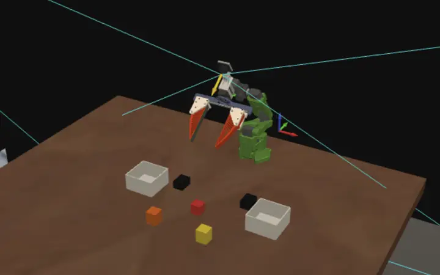
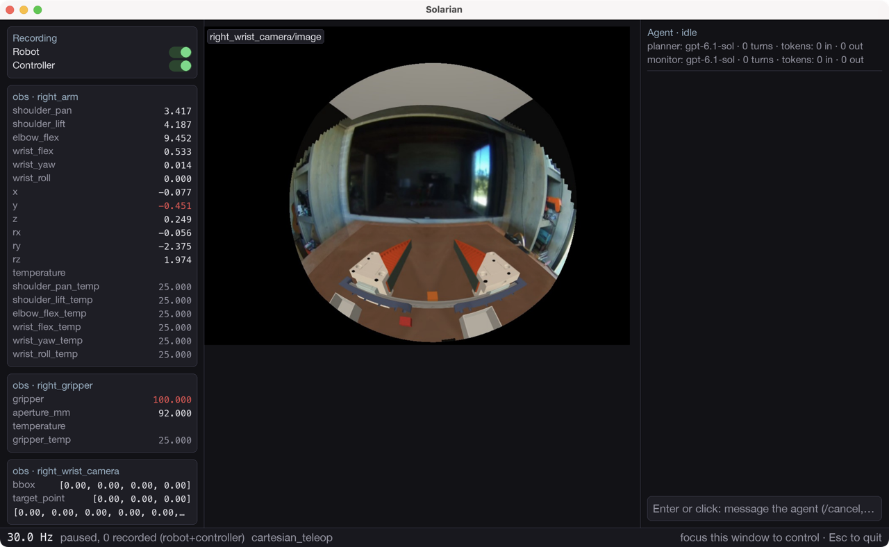

# Solarian

<div align="center">

[](https://www.python.org/downloads/)
[](LICENSE)
[](https://pypi.org/project/solarian/)
[](https://pypi.org/project/solarian/)
[](https://discord.gg/S7rfmJfpm5)

</div>

**Solarian** is an open-source robotics framework designed to build, simulate, teleoperate, train, and deploy robots. From hardware to AI control in one Python stack.

Solarian brings the developer experience of a modern Python library to robotics, and it is built around low level control using learned policies: ACT, diffusion policies, rather than hand-programmed logic alone. Plus high level control using an agentic harness around VLMs. At the structural level, a robot is a Python class made of modules, each module a class made of sensors and actuators. The same project runs in simulation and on hardware, and recording, training, and serving a policy all happen inside the framework.

The goal is to have modularized robots, that can be reused, not only their structure, but their skills. Solarian adopts [UMI](https://umi-gripper.github.io/) as its main path to learning manipulation: demonstrations come from a handheld gripper, and policies describe the gripper's motion rather than one arm's joints, so a trained skill can run on another compatible arm without new data. Open hardware and models live alongside the code, as building blocks for people and AI agents alike. Read more in [Why I created Solarian](https://www.raulgarreta.com/posts/why-i-created-solarian).

## Features

- **[Real-time modules](https://solarian.dev/docs/modules).** A robot is built from modules such as an arm, a gripper, or a camera. Each runs in its own process at its own rate, so a 500 Hz arm never waits on a 30 Hz camera.
- **[Kinematics built in](https://solarian.dev/docs/ik).** Command the end effector, and the module solves inverse kinematics every tick. Command the joints, and the module solves forward kinematics too.
- **[AI Controller](https://solarian.dev/docs/ai_controller).** A vision-language model plans the task and picks the skill to run, while skills handle the faster control underneath.
- **[Simulation built in](https://solarian.dev/docs/simulation).** `solarian run-robot --sim` runs the same robot class and YAML in MuJoCo instead of on hardware.
- **[Plugins](https://solarian.dev/plugins).** Solarian is extensible by design: actuators and sensors (servos, cameras, etc), modules (arms, grippers, etc), skills (low level learned policies and heuristics) install as plugins, config included. `solarian create-plugin` starts your own.
- **[Recording](https://solarian.dev/docs/recording), [datasets](https://solarian.dev/docs/datasets), and [training](https://solarian.dev/docs/training).** Record every camera and signal at its native rate, curate episodes, train diffusion, ACT, or UMI policies, and serve them back to the robot.
- **[Typed observations and actions](https://solarian.dev/docs/observations) and [Hydra configuration](https://solarian.dev/docs/project-configs).** Pydantic schemas bound to your modules, and composable YAML you can override from the command line.

## Getting started

```bash
pip install solarian
pip install "solarian[all]"   # optional: AI, AI controller, and simulation extras
```

Visit our [Documentation](https://solarian.dev/docs/overview) to get started with Solarian.

Visit the [Tutorials](https://solarian.dev/docs/tutorials) to learn Solarian by building a demo robot arm project.

## A quick look

This is a trimmed version of `arm1`, a [Solarian Arm 1](https://solarian.dev/hardware) with a UMI-style gripper and a wrist camera. A robot is a class whose attributes are its modules. The `scene` is what `--sim` uses to build the MuJoCo world.

```python
from solarian.core import Robot
from solarian.core.picamera_module import PiCameraModule
from solarian.sim import CameraMount, ModuleAttachment, SceneConfig
from solarian_arm_1 import ARM_MJCF_PATH
from solarian_arm_1.arm import Arm1Module
from solarian_umi_skill import UMISkill
from solarian_umi_slim import MJCF_FEETECH_PATH as UMI_SLIM_MJCF
from solarian_umi_slim.umi_slim_feetech import UmiSlimFeetechModule


class Arm1Robot(Robot):
    right_arm = Arm1Module(ik_tcp=UmiSlimFeetechModule.tcp_from_flange)
    right_gripper = UmiSlimFeetechModule()
    right_wrist_camera = PiCameraModule()

    skills = (UMISkill,)

    scene = SceneConfig(
        world_mjcf="assets/sim_scene.xml",
        attachments=[
            ModuleAttachment(module="right_arm", mjcf=ARM_MJCF_PATH, parent_body="world", prefix="right/"),
            ModuleAttachment(
                module="right_gripper",
                mjcf=UMI_SLIM_MJCF,
                parent_site="right/flange",
                child_site="flange",
                prefix="right_gripper/",
            ),
        ],
        # A MuJoCo camera looks down -Z; the exported camera frame's +Z points away from the gripper.
        cameras=[CameraMount(name="right_wrist_cam", site="right_gripper/camera", quat=[0.0, 1.0, 0.0, 0.0], fovy=160.0)],
    )
```

The controller decides what the robot does. Here it teleoperates the arm from the keyboard, binds keys to skills, and lists the skills the AI controller may call as tools:

```python
from solarian.core import Controller
from solarian.core.event import Event, EventType, event_handler
from solarian.core.skill import Tool
from solarian_move_skill import MoveSkill
from solarian_umi_skill import UMISkill
from solarian_umi_slim.aperture import APERTURE_CLOSED_MM, APERTURE_OPEN_MM

from arm1.skills import CartesianTeleopSkill

ARM = {"arm": "right_arm", "gripper": "right_gripper"}
TELEOP = {**ARM, "frame": "ee", "gripper_min_mm": APERTURE_CLOSED_MM, "gripper_max_mm": APERTURE_OPEN_MM}


class Arm1Controller(Controller):
    use_gui = True

    skills = (CartesianTeleopSkill, MoveSkill, UMISkill)

    tools = {
        "move_to_pose": Tool(MoveSkill, ARM),
        "pick_object": Tool(UMISkill, {"config": "pick_object.yaml"}),
    }

    def on_start(self):
        self.start_skill(CartesianTeleopSkill(params=TELEOP))

    @event_handler(EventType.KEY_DOWN)
    def start_bound_skill(self, event: Event) -> None:
        match event.data.get("key"):
            case "0":
                self.start_skill(MoveSkill(params={"pose": "home", **ARM}))
            case "4":
                self.start_skill(UMISkill(params={"config": "pick_object.yaml"}))
```

Run the relay server, the robot, and the controller from the project directory. Each can run on a different machine; `--deployment` picks the profile in `conf/deployment/` that says where.

```bash
solarian run-server
solarian run-robot --sim     # drop --sim to drive the real arm
solarian run-controller
```

The simulated arm going to its ground pose, jogged from the keyboard, then back home:

<p align="center">
  
</p>

The controller window shows the live observations, the wrist camera, and the AI controller's chat:

<p align="center">
  
</p>

<!-- The real Solarian Arm 1, seen from outside. Record media/readme/arm1-real.webp, then uncomment:
<p align="center">
  
</p>
-->

## Community

To chat with other community members, you can join the [Solarian Discord server](https://discord.gg/S7rfmJfpm5).

## Contributing

Solarian is early, and contributions are welcome. A few guidelines to start with:

- For anything larger than a small fix, open an issue or ask on [Discord](https://discord.gg/S7rfmJfpm5) before writing the code, so we can agree on the approach.
- To work on Solarian itself, install it from source and run the tests:

  ```bash
  git clone https://github.com/solarian-dev/solarian.git
  cd solarian
  pip install -e ".[all]"
  pytest tests/
  ```

  On Apple Silicon that install builds `atomics` from source, and `xformers` with the `ai` extra (`.[all]` includes it). It needs git and a C compiler.
- New hardware support and skills usually belong in a plugin rather than in the core. Start one with `solarian create-plugin`, and list it in the [Plugin Directory](https://solarian.dev/plugins/submit).

A `CONTRIBUTING.md` and a code of conduct are coming.

## License

Solarian is licensed under the [Apache License 2.0](LICENSE). Copyright 2026 PrimaryKey Inc. Vendored third-party code keeps its own license; see [NOTICE](NOTICE). Model weights are downloaded separately and keep their upstream licenses.

Solarian and the Solarian logo are trademarks of PrimaryKey Inc. See the [trademark policy](TRADEMARKS.md).
