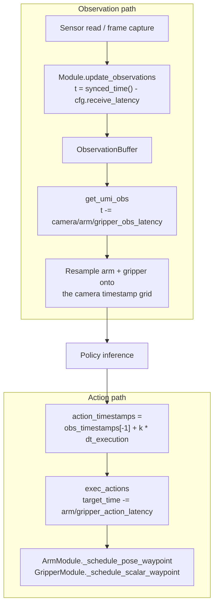

export const metadata = {
  title: 'Latency & Synchronization',
  description:
    'How UMI-style skills compensate for sensing and actuation delay: the five latency parameters, which direction each one corrects, why the camera is the master clock, and how to measure every value on your own hardware with calibrate-arm-latency, calibrate-gripper-latency and calibrate-camera-latency.',
}

# Latency & Synchronization

A robot never sees the present. The frame a policy looks at was true a moment ago, and the command it produces will land a moment from now. Latency compensation is how a [Skill](/docs/skills) puts those two moments back in the relationship the policy was trained on. Get the numbers wrong and the robot reaches for where the cup *was*, or arrives where the cup *will be* before it gets there. {{ className: 'lead' }}

This page describes the UMI ([Universal Manipulation Interface](https://umi-gripper.github.io/)) compensation scheme as Solarian implements it, and how to measure every parameter with the `calibrate-*-latency` [commands](/docs/commands).

## The problem

A diffusion policy is trained on demonstrations. In the training data, an image at time `t` is paired with the action the human took at `t`. The policy learns that pairing — a mapping from what the scene looked like *then* to what to do *then*.

At evaluation time neither `t` is available directly:

- The image you have is not the scene now. It was exposed, transferred, decoded and published; by the time the policy sees it, it describes the past.
- The action you compute will not execute now. It has to travel to the module, through an interpolator, onto a bus, and into a servo that then has to physically move.

Compensation exists to **reproduce the training-time relationship**, not to make the robot faster. You cannot recover the lost time; you can only label each quantity with the instant it was actually true, so the policy is fed a consistent picture and its output is aimed at the right future instant.

## The five parameters

A UMI skill config carries one latency per modality per direction. From [`conf/cup_arrange.yaml`](https://github.com/solarian-dev/solarian/blob/main/projects/so106/conf/cup_arrange.yaml):

```yaml
camera_obs_latency: 0.194

arms:
  - arm_obs_latency: 0.000124
    arm_action_latency: 0.12

grippers:
  - gripper_obs_latency: 0.01
    gripper_action_latency: 0.132
```

<Properties>
  <Property name="camera_obs_latency" type="float (s)">
    Exposure to the moment <code>update_observations</code> stamps the frame: sensor readout, ISP, transfer, colour conversion, optical remap, publish. The largest and most variable of the five.
  </Property>
  <Property name="arm_obs_latency" type="float (s)">
    Bus round trip for a joint position read plus forward kinematics. On a Feetech serial bus this is a real read duration, not a poll off a streaming interface.
  </Property>
  <Property name="gripper_obs_latency" type="float (s)">
    Same, for the gripper's aperture read.
  </Property>
  <Property name="arm_action_latency" type="float (s)">
    Waypoint scheduling to the end-effector actually being at the commanded pose: queue hop, interpolator, IK, bus write, servo response.
  </Property>
  <Property name="gripper_action_latency" type="float (s)">
    Same, for the jaws reaching a commanded aperture.
  </Property>
</Properties>

**The two kinds correct in opposite directions, and they are not interchangeable.**

An **observation latency** moves a timestamp *backwards*. The value we just read was physically true earlier than the instant we stamped it, so we subtract the delay to recover when it was true.

An **action latency** moves a target time *earlier*. If we want the arm to be somewhere at `t`, we have to ask for it at `t - arm_action_latency` so the pipeline delay is spent before the deadline rather than after it.

Conflating them is the single easiest mistake here: they have the same units, similar magnitudes, and the same modality names, but adding one where the other belongs doubles the error instead of cancelling it.

## The observation path



Every module stamps its readings the same way, in [`Module.update_observations`](https://github.com/solarian-dev/solarian/blob/main/solarian/core/module.py):

```python
sensor_data[sensor_name]['timestamp'] = synced_time() - self.cfg.receive_latency
```

`synced_time()` is wall time on the relay server's clock (see [`clock_sync.py`](https://github.com/solarian-dev/solarian/blob/main/solarian/core/clock_sync.py)), so a camera on a Raspberry Pi and an arm on a laptop produce timestamps that can be subtracted from one another. This matters more than it sounds: without it, an OS clock disagreement of 80 ms is indistinguishable from 80 ms of camera latency, and the compensation would be tuned to absorb a clock error.

The skill then backdates each modality by its own obs latency and resamples everything onto one grid:

```python
cam_ts  = camera_timestamps  - self.camera_obs_latency
arm_ts  = arm_timestamps     - self.arm_obs_latency
grip_ts = gripper_timestamps - self.gripper_obs_latency

last_timestamp = float(cam_ts[-1])
```

### The camera is the master clock

`last_timestamp` comes from the camera and nothing else. Arm and gripper histories are then interpolated (`PoseInterpolator`, `get_interp1d`) onto grids anchored to that same instant, so the observation the policy receives is "the scene at `cam_ts[-1]`, and where the arm and gripper were at that same instant".

The camera gets to define "now" for three reasons:

1. It is the slowest and most variable modality by an order of magnitude — proprioception is a bus read, an image is a whole pipeline.
2. It is the policy's only exteroceptive input. Everything the policy knows about the cup comes from that frame, so the frame's instant is the only one the scene is described at.
3. Proprioception is cheap to move in time. Joint positions are smooth and densely sampled, so interpolating them to the camera's instant costs almost nothing, whereas interpolating an image would be meaningless.

The consequence is that `camera_obs_latency` is not one parameter among five. It is the anchor the whole chunk hangs from, and an error in it propagates into every action timestamp.

## The action path

Inference produces a chunk of poses, and the skill turns them into absolute times:

```python
dt_execution = self.policy_dt * self.execution_speed_scale
action_timestamps = np.arange(1, len(poses) + 1) * dt_execution + obs_timestamps[-1]
```

Note the anchor: `obs_timestamps[-1]`, which *is* the backdated camera timestamp. The chunk is scheduled relative to when the scene was true, not relative to now. That is correct — the policy's k-th action means "`k * dt` after the moment shown in this image" — but it means the whole chunk starts out `camera_obs_latency + inference_time` in the past, and only the waypoints beyond that are still schedulable.

Then `exec_actions` applies the action latencies, per modality:

```python
arm_target_time  = ts - self.arm_action_latency
grip_target_time = ts - self.gripper_action_latency
```

The arm and gripper get **different** target times for the same predicted step, deliberately: the jaws and the end-effector have different pipelines, so hitting the same physical instant requires sending each one at its own lead time.

Finally, each waypoint reaches its module and is handed to a `TrajectoryInterpolator` (see [Scheduling Waypoints](/docs/modules/scheduling-waypoints)). A waypoint whose time has already passed does not blend in; [`_resolve_waypoint_time`](https://github.com/solarian-dev/solarian/blob/main/solarian/core/actuator_module.py) clamps it to the very next control period and logs it:

```text
Module 'right_arm': clamping late SCHEDULE_WAYPOINT (183.4 ms late)
```

Those log lines are the symptom to watch for. A clamped waypoint is a step of the trajectory compressed into one control period — the smooth descent the policy planned becomes a jerk.

## Why an over-estimated `camera_obs_latency` breaks grasping

Suppose the true camera latency is 40 ms but the config says 194 ms, copied from a UMI rig. Then:

1. `cam_ts[-1]` is backdated 154 ms too far.
2. Every `action_timestamp` in the chunk inherits that 154 ms.
3. With `policy_dt = 0.1` and `execution_speed_scale = 1.5`, `dt_execution` is 150 ms, so the first waypoint of every chunk lands in the past and gets clamped.
4. The arm jumps to waypoint two instead of easing through waypoint one.

Worse, arm and gripper are pulled apart. The chunk error is common to both, but they subtract different action latencies from it (0.12 vs 0.132 in the shipped config), and their interpolators have different speed limits, so they absorb the same lateness differently. A grasp is a race between descending and closing; when the descent gets clamped and the closing does not, the jaws start shutting before the fingers are around the cup. Seen from outside, the robot "grabs from too high" — the gripper reaches its commanded aperture at a height the policy intended it to have already passed.

The general rule: **an obs latency that is too large makes the robot act on a stale future, and an action latency that is too large makes it act early.** Both show up as spatial error on a moving trajectory, and both look like a bad policy rather than a bad number.

## Measuring each value on your hardware

The values shipped in `cup_arrange.yaml` came from UMI's `example/eval_robots_config.yaml`, which describes a UR5 over RTDE, a WSG gripper, and a GoPro through an Elgato HDMI capture card. **They are a placeholder, not a default.** Nothing about a Feetech serial bus and a Pi CSI camera resembles that rig.

### Where to run these

Every one of these commands opens the hardware itself, in-process, the way `solarian calibrate` does. So each runs **on the machine the device is physically wired to** — under the `pi` deployment that is the Raspberry Pi for the arm, the gripper and the camera; under `localhost`, where everything is on one machine, it is that machine. The operator path that includes this step — after the limit sweep and IK alignment — is [Calibration](/docs/modules/calibration#calibrate-latencies).

Two consequences:

- **Stop `run-robot` first.** The serial bus and the CSI camera can only be open once, and the calibration process wants them.
- **`calibrate-camera-latency role=display` is the exception.** It touches no hardware, so it runs wherever the monitor is — your laptop — while `role=capture` runs on the robot. That is the whole reason the command has roles.

You *can* run both roles on the robot if it has a screen attached: the display role opens no bus, so the two processes do not conflict, and sharing one OS clock makes the subtraction exact (`allow_unsynced=true` covers you if the relay is not up). It is the worse measurement, though, for two reasons that both inflate the result. `l_display = 1.5 / f_monitor` models a conventional VSync pipeline, and a Pi driving HDMI through a software compositor is slower and more variable than that. And the two processes compete for CPU, which delays the capture read and pushes `t_recv` later. Use a separate machine for the screen when you can.

The commands search both your `Robot` and your `Controller` class for a matching module, so a gripper mounted on a leader arm is found too. A half that cannot be imported is skipped with a message rather than failing the command — a robot machine is not expected to have controller-side plugins installed, which is exactly what `setup_modules` exists to avoid.

### `camera_obs_latency`

```bash
# on the machine with a monitor
solarian calibrate-camera-latency role=display

# on the robot, camera pointed at that monitor
solarian calibrate-camera-latency role=capture monitor_hz=60
```

This is UMI's method, from the paper:

```text
l_camera = t_recv - t_display - l_display - l_hold
l_display ~= 1.5 / f_monitor
l_hold    ~= hold / (sightings + 1)
```

The display role fills a screen with a QR code encoding the instant it was drawn, refreshed every frame. The capture role films it, decodes the code, and subtracts. `l_display` accounts for the fact that `imshow` returning is not the same as photons leaving the panel — with VSync the frame is on the glass roughly one and a half refreshes later, which is why `monitor_hz` is required rather than optional.

Both roles call `synced_time()`, and both sync to the relay on startup, so the screen and the camera may be on different machines. If sync fails the command refuses to report a number; pass `allow_unsynced=true` only when both roles are on the same machine.

A QR code seen in several consecutive frames only measures latency on the first one — after that it is the monitor that has not refreshed — so the command keeps the first receipt per unique display timestamp.

`l_hold` is the correction that pairs with that. Stamping a new QR every vsync makes a 30 fps exposure a blend of several payloads: the finder patterns still match, so the code is detected, but decode returns empty. The display therefore holds each code for `1/15 s` regardless of panel rate. A held code is drawn once and filmed later, so the payload in any given exposure is already part-way through its hold window, and the measurement inherits that offset. Keeping the first of `k` sightings lands about `hold / (k + 1)` into the window, which the command subtracts.

Watch the `sightings per QR` figure in the output. When it is comfortably above one, the dedup is doing the work and the correction is small. When it is exactly one — `frames decoded` equal to `unique QR` — every code was seen once, no dedup ever fired, and `l_hold` is an assumed half-window of 33 ms rather than something the data measured. That is the dominant term in the spread, so it is worth making decode faster than the display updates. On a Pi the loop is decode-bound, not camera-bound: a rate near 6 reads per second against a 30 fps camera means the QR detector, not the pipeline, is setting the sample rate.

`monitor_hz` is optional on the display role, where it only paces the redraw (default 60). Refreshing faster than the panel presents buys nothing and costs a core. On exit that role also reports its mean encode-and-draw time: the QR is stamped before it is encoded, so that time lands inside whatever the capture side measures. A couple of milliseconds is noise; a large share of the result means the screen is on too slow a machine.

### `arm_action_latency` and `gripper_action_latency`

```bash
solarian calibrate-arm-latency          # then pick mode 1 (action)
solarian calibrate-gripper-latency      # then pick mode 1 (action)
```

Both work by cross-correlation, ported from UMI's `calibrate_gripper_latency.py`. The module is commanded a sinusoid of timestamped waypoints; the measured position is recorded alongside; [`get_latency`](https://github.com/solarian-dev/solarian/blob/main/solarian/utils/latency.py) resamples both onto a common grid, z-scores them, and finds the lag that maximises correlation. That lag is the end-to-end command-to-motion delay.

The arm version sweeps one Cartesian axis (`axis=z` by default, `amplitude=0.02` metres, `freq=1.25` Hz) and returns to its start afterwards. It refuses to run if the sinusoid's peak velocity `2 * pi * f * amplitude` would exceed the module's `max_speed`: `PoseTrajectoryInterpolator` stretches any waypoint it cannot reach in time, so a too-fast sweep measures the speed limit instead of the pipeline. That check runs before the hardware is opened, so a bad amplitude costs you nothing.

This makes `max_speed` a prerequisite rather than a detail. Measure it first with [`calibrate-arm-speed`](/docs/commands#calibrate-arm-speed) and [`calibrate-gripper-speed`](/docs/commands#calibrate-gripper-speed) — a guessed limit that is too low silently caps every sweep the latency calibration then runs against it. See [Why the speed limit matters](#why-the-speed-limit-matters) below.

You choose where the sweep happens. The command records where the arm started, hands it to you, and puts it back at the end:

```text
Put the end-effector where the sweep should be centred, with 2.0 cm clear
either side along z.
Take hold of the arm, then press Enter to release torque...
Torque is OFF. Move the arm, then press Enter while still holding it...
Torque is ON. Let go of the arm, then press Enter...
```

Each prompt is a point where a hand has to be somewhere specific. Torque is released only after you confirm you are holding the arm, because a servo arm falls the instant it is let go — disengaging in the same breath as printing the warning drops it before the warning has been read. Servos also keep their last `Goal_Position` through a torque-off, so the module latches the measured joints (`hold_measured_pose`) before re-energising, or the arm snaps back to wherever it was commanded before you moved it. And the centre pose is read only once you have let go: held, it includes whatever you were supporting; released, it is the pose the servos actually hold against gravity, which is what the sweep will be centred on.

The starting pose is recorded before any of this and restored afterwards, including when the calibration aborts partway.

It then checks that the model can still travel the full amplitude both ways from there, via `ArmModule.reachable_travel`, and aborts naming the joint that stopped it. This check exists because differential IK does not fail on an out-of-reach target — mink enforces the model's configuration limits, so the solver simply converges short, the sinusoid comes back clipped, and the cross-correlation reports the clip rather than the pipeline delay. Nothing here knows about obstacles; clearing the volume is still yours to judge.

Do not lower `freq` further than you have to. Cross-correlating a narrowband signal gives a broad peak that the finite recording window pulls toward zero lag, and the resulting bias grows as the frequency drops — around 18 ms at 0.5 Hz over a 10 s sweep, against 2 ms at 1.25 Hz. Reduce `amplitude` first.

Both commands drive the module through `schedule_pose` / `schedule_scalar`, which pass `drop_timestamps=False`. That matters when the module yaml sets `drive_waypoints: true` for teleop: the normal path would collapse the timestamped sinusoid into "drive to the latest target now", which destroys the very timing being measured.

### `arm_obs_latency` and `gripper_obs_latency`

```bash
solarian calibrate-arm-latency          # then pick mode 2 (obs)
solarian calibrate-gripper-latency      # then pick mode 2 (obs)
```

There is no cross-correlation to run here, and no external reference to correlate against. `update_observations` stamps `synced_time()` *after* the read returns, so the reading it stamps was physically true roughly one read-duration earlier. Mode 2 times a few hundred reads and reports the mean.

Expect single-digit milliseconds for a Feetech serial round trip. UMI's `0.000124` is not a comparable number: their UR5 pulls the latest sample off a 500 Hz RTDE stream, so their "read" is a memory access, not a bus transaction.

## Why the speed limit matters

`max_speed` belongs on this page because it is not a throttle. It never slows a module down; it moves a waypoint's arrival time later, in [`PoseTrajectoryInterpolator.schedule_waypoint`](https://github.com/solarian-dev/solarian/blob/main/solarian/utils/trajectory_interpolator.py):

```python
        duration = time - end_time
        end_pose = trimmed_interp(end_time)
        pos_dist, rot_dist = pose_distance(pose, end_pose)
        pos_min_duration = pos_dist / max_pos_speed
        rot_min_duration = rot_dist / max_rot_speed
        duration = max(duration, max(pos_min_duration, rot_min_duration))
        assert duration >= 0
        actual_last_waypoint_time = end_time + duration
```

The pose is kept exactly; what changes is when it is due. Every guarantee on this page rests on "the pose asked for at time T is the pose achieved at T", so a stretched waypoint breaks the contract that latency compensation is built on, and anything measuring command-to-motion delay measures the stretch instead.

It also accumulates. `end_time` is `max(last_waypoint_time, curr_time)` where `last_waypoint_time` is the already-stretched value, so a chunk that is systematically too fast does not settle at a fixed offset — each waypoint queues behind the previous stretched one and the arm falls further behind. When the next chunk arrives with timestamps earlier than `last_waypoint_time` the plan resets to `curr_time` and the stretched tail is discarded. Lag, then snap.

Removing the limit does not help, because the hardware's limit exists either way — `max_speed` is only your model of it. Without it the interpolator emits a path the servos cannot track, and the discrepancy moves from something visible in the commanded timestamps to invisible tracking error. Set it below the truth and you manufacture the lag above; set it above and you get silent tracking error. Measure it: [`calibrate-arm-speed`](/docs/commands#calibrate-arm-speed) and [`calibrate-gripper-speed`](/docs/commands#calibrate-gripper-speed).

## `receive_latency` versus `*_obs_latency`

Two places can correct the same delay:

- `ModuleConfig.receive_latency`, subtracted at the point of stamping in `update_observations`, and applied to every consumer of that module.
- The skill's `camera_obs_latency` / `arm_obs_latency` / `gripper_obs_latency`, subtracted inside the skill.

They compensate the same physical quantity. `receive_latency` defaults to `0.0` and is unset in every so106 module yaml, so nothing is double-counted today — but the overlap is a trap worth stating explicitly.

**Keep the correction in one place, and prefer the skill's config** for modules a UMI skill reads. The reason is that a latency figure only means something next to the policy it was measured for: the numbers live beside the checkpoint that assumes them, and are reviewed when the checkpoint changes. Set `receive_latency` only for modules with a genuinely known, consumer-independent transport delay — and if you do, remember to take it back out of the skill's value.

## What to expect on real hardware

| Parameter | UMI published (UR5 / WSG / GoPro) | Order of magnitude on an SO-106 rig |
| --- | --- | --- |
| `camera_obs_latency` | 0.194 | Tens of ms — a CSI sensor is not an HDMI capture card |
| `arm_obs_latency` | 0.000124 | A few ms — one serial round trip, not an RTDE poll |
| `gripper_obs_latency` | 0.01 | A few ms — same bus as the arm |
| `arm_action_latency` | 0.12 | Measure it — depends on module `frequency` and servo response |
| `gripper_action_latency` | 0.132 | Measure it — typically larger than the arm's, the jaws are slower |

The third column is a sanity check on your measurement, not a value to copy. Copying is what produced the problem this page exists to prevent.

### A structural fix worth knowing about

[`picamera_bus.py`](https://github.com/solarian-dev/solarian/blob/main/solarian/core/picamera_bus.py) calls `capture_array` and discards the frame metadata, so our frame timestamp is the publish time and `camera_obs_latency` has to absorb the entire pipeline. picamera2 also exposes `capture_metadata()["SensorTimestamp"]` — the exposure instant, in `CLOCK_BOOTTIME` nanoseconds. Stamping frames from that instead would move most of this delay out of a hand-tuned constant and into a measured one, shrinking `camera_obs_latency` toward zero. It is not wired up today.

## Verifying the result

After setting measured values, two things should change.

`_run_inference` logs how much of each chunk is still schedulable:

```text
Scheduled 16 waypoints (16 in the future)
```

With correct latencies that count should be the full chunk, or very close. If it reads `(9 in the future)`, the anchor is too far in the past — either `camera_obs_latency` is over-estimated or inference is slower than the lookahead.

And the arm module should stop logging clamped waypoints:

```text
Module 'right_arm': clamping late SCHEDULE_WAYPOINT (183.4 ms late)
```

Any occurrence of that line during a policy run means waypoints are arriving after their deadline, and the trajectory the robot executes is not the one the policy planned.

## See also

- [Calibration](/docs/modules/calibration#calibrate-latencies) — the bring-up home for this step (limit sweep, IK, then these measurements)
- [Commands](/docs/commands) — the `calibrate-*-latency` commands in full
- [Scheduling Waypoints](/docs/modules/scheduling-waypoints) — how a timestamped waypoint becomes motion
- [Observations](/docs/observations) — the schema the timestamps travel in
- [Skills](/docs/skills) — where a policy's chunk is turned into actions
- [UMI](https://umi-gripper.github.io/) — the paper this scheme comes from
