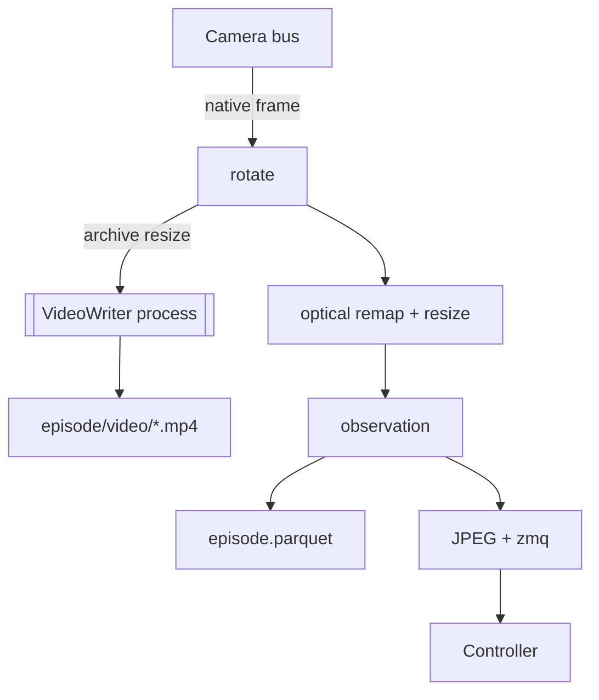

export const metadata = {
  title: 'Recording',
  description:
    'How Solarian records episodes: the robot writes one mp4 per camera at archive resolution and one parquet of every signal at its native rate, so a dataset keeps the quality the sensor produced rather than the resolution today’s policy happens to want.',
}

# Recording

A dataset outlives the policy it was collected for. The resolution your policy trains at today is not the resolution you will want in two years, and no amount of later work recovers pixels a downscale threw away — so Solarian records the frame the sensor produced, not the frame the policy consumes. {{ className: 'lead' }}

Everything on this page follows from one decision: **the robot records, end to end.** It is the only process that ever sees a full-resolution frame.

## Why the robot and not the controller

The observation a controller receives has been downscaled to the policy's input size, optically remapped, and JPEG-compressed — three irreversible losses, applied before the frame leaves the robot. On top of that, every hop of the link is `ZMQ_CONFLATE`: a controller that stalls for a tick does not get a backlog, it gets the latest frame and a hole where the others were. That is the right trade for teleop and the wrong one for a dataset.

So the camera bus tees each captured frame to an encoder process *before* the observation path touches it, and the table is written in the robot's main process from the observations it publishes. Nothing about the dataset depends on the network being up.



## On disk

```text
datasets/<name>__2026-09-22T19-04-11/
├── session.json          written once, then immutable
├── manifest.jsonl        appended and fsynced once per sealed episode
└── episodes/000000/
    ├── episode.json
    ├── episode.parquet
    └── video/<module>.<field>.mp4
```

<Properties>
  <Property name="session.json" type="written once">
    What makes an episode directory self-describing: column dtypes and units, camera geometry, the optical remap and resize that export has to apply because the archive is stored raw, the Solarian version and the git sha.
  </Property>
  <Property name="episode.parquet" type="one per episode">
    Every low-dimensional signal — observations, the actions the robot received, and one frame index per camera. Zstd-compressed, written in row groups as the episode runs, so a hard kill costs one row group rather than the episode.
  </Property>
  <Property name="episode.json" type="written at seal">
    Selection metadata: duration, row count, status, task, measured rate per module, per-camera frame count and coverage, and running statistic sums. Enough to choose episodes without opening a parquet file.
  </Property>
  <Property name="manifest.jsonl" type="append-only">
    The durability ledger, fsynced per line. A torn last line costs you one entry instead of the record of what has already been uploaded.
  </Property>
</Properties>

### Why mp4 and parquet rather than one array store

Video and tabular data have nothing in common but the clock. H.264 exploits the fact that consecutive frames are nearly identical, which is worth an order of magnitude over storing frames as independent images in an array store. The low-dimensional side is the opposite case: a few hundred heterogeneous scalar columns with a schema, which is what Parquet is for and what an N-dimensional array store has to be talked into.

### One row per module update, not one row per tick

A table sampled at 30 Hz throws away an arm running at 90 Hz and a gripper at 120 Hz. Solarian writes a row whenever *any* module publishes a new sample, so each signal keeps its own cadence and nothing is resampled until export, when the target rate is finally known. A signal that did not advance carries its previous value forward; the per-module `ts` column is what tells a consumer how stale each one was.

Cameras are the exception: the table stores a frame index and a capture timestamp rather than pixels. The recorder and the encoder both derive that index from the same `(start_time, fps)`, so no index ever crosses a process boundary and a dropped message cannot desynchronise the video from the table.

## Configuring it

Two files, split by who owns the decision. The robot's `conf/robot.yaml` decides *where and how* an episode is stored:

```yaml
recording:
  enabled: true
  root: datasets
  crf: 20        # near-transparent; survives a later re-encode
  keyint: 30     # short GOPs buy cheap random access at training time
  preset: veryfast
  threads: 1     # per camera, out of the cores the control loop also wants
  max_session_gb: 64.0
```

Recording is on by default, because a teleop session that was not recorded cannot be recovered and the cost of an mp4 nobody wanted is a deletion. `max_session_gb` is the counterweight: on-by-default without a cap fills an SD card.

`root` has to be a disk on the machine running the robot. A relative path resolves against the project, which is the right default only while the project is local — if the project is a network mount, the default puts the link in the encoder's path, and the encoder is already the tightest budget on a single-board computer. Point `root` at local storage and let the transfer step move episodes afterwards.

Archive resolution is per camera, in the camera's own config:

```yaml
sensors:
  camera:
    width: 2028          # what the sensor is opened at
    height: 1520
    resize_width: 1014   # what the observation carries
    resize_height: 760
    archive_width: 1014  # what is recorded
    archive_height: 760
```

Leave `archive_*` unset to record at the sensor's full resolution. It exists because a Raspberry Pi 5 has no hardware H.264 encoder, so the archive size is bounded by what software x264 keeps up with — measure before raising it.

Prefer a size that divides the sensor by a whole number. `cv2.resize` with `INTER_AREA` only takes its fast path at integer ratios, and the difference is not subtle: on a Pi 5, 2028x1520 down to 1014x760 costs 1.5 ms, while 1332x1000 — a 1.523 ratio, only 42% more pixels — costs 33.6 ms, which is a whole core at 30 fps. Re-encoding real wrist-camera footage on a Pi 5, the encoder itself costs 0.51 of a core at 1014x760 and 0.97 at 1332x1000. Skipping the resize entirely and archiving the native 2028x1520 is the worst of both: 2.88 cores, because the 1.5 ms of resize you save buys you seventy of encoding.

## Recording a session

Recording is on while you teleop, so `solarian run-controller` already records. Press `r` to seal the episode and open the next one, `delete` to throw the current one away and re-record it.

To start idle instead and open the first episode by hand, set `record: false` in the controller's config. That is a different switch from the robot's `recording.enabled`, and the two answer different questions: `recording.enabled` is whether the robot can record at all, while `record` is only whether an operator has to press a key first. Turning `enabled` off to get a quiet startup also means `r` does nothing and `solarian record` refuses to run. `solarian record` ignores `record` either way, since it opens and seals every episode itself.

For a deliberate collection run, `solarian record` cuts the same teleop loop into episodes:

```bash
solarian record num_episodes=50 episode_time_s=20 name=cup_stacking
```

```yaml
# conf/record.yaml — only the shape of the session
name: cup_stacking
num_episodes: 50
episode_time_s: 30.0   # null records until you press r or delete
reset_time_s: 5
reset_period: 1
tasks: []              # one episode per task, cycled
```

The controller keeps teleoperating between episodes as much as during them, so you reset the scene by hand and nothing is torn down and rebuilt between takes. Pressing `delete` reuses the episode index, so a bad take leaves no gap in the dataset.

`name` names the session directory on the robot; a timestamp is appended, so a rerun gets its own directory rather than mixing its episodes in with ones an older build wrote.

<Note>
  An episode boundary is the one action that must not be dropped — a lost `RECORD_STOP` leaves the next take appended to this one. The controller therefore resends a boundary every tick until the robot echoes the request id back in its observation, and gives up loudly after three seconds rather than silently corrupting an episode.
</Note>

## Exporting a training set

A session is not a training set, deliberately. Export is where the irreversible choices are finally made — a target rate, a policy resolution, a warped image — and because the session never changes, they are all cheap to redo.

```bash
solarian export-dataset datasets/cup_stacking__2026-09-22T19-04-11
```

That writes a [LeRobot](https://github.com/huggingface/lerobot) v2.1 dataset, which is what `solarian train` reads and what PrimaryKey ingests:

```text
lerobot/
├── meta/{info.json,episodes.jsonl,episodes_stats.jsonl,tasks.jsonl}
├── data/chunk-000/episode_000000.parquet
└── videos/chunk-000/observation.images.<camera>/episode_000000.mp4
```

Two things happen on the way. Every signal is resampled onto one grid by sample-and-hold, because LeRobot's contract is that row *i* is the state at `i / fps` — and holding the last reported value is the only resampling that cannot invent a reading the robot never produced. And every frame is warped through the camera's optical remap and downscaled to `resize_width`/`resize_height`, which is the step the robot skipped on purpose.

Recalibrate a camera and re-export, and past datasets pick up the new geometry. Decide the policy wants a different rate, or a resolution the archive can still supply, and re-export. Pass `--no-remap` to keep the archive geometry untouched, which is what a re-calibration or a higher-resolution experiment wants.

Episodes whose video did not seal are marked `video_failed` at record time and skipped here. An encoder that cannot keep up is a recording problem, and silently exporting a table whose frame indices point at frames that were never written would turn it into a training problem.
