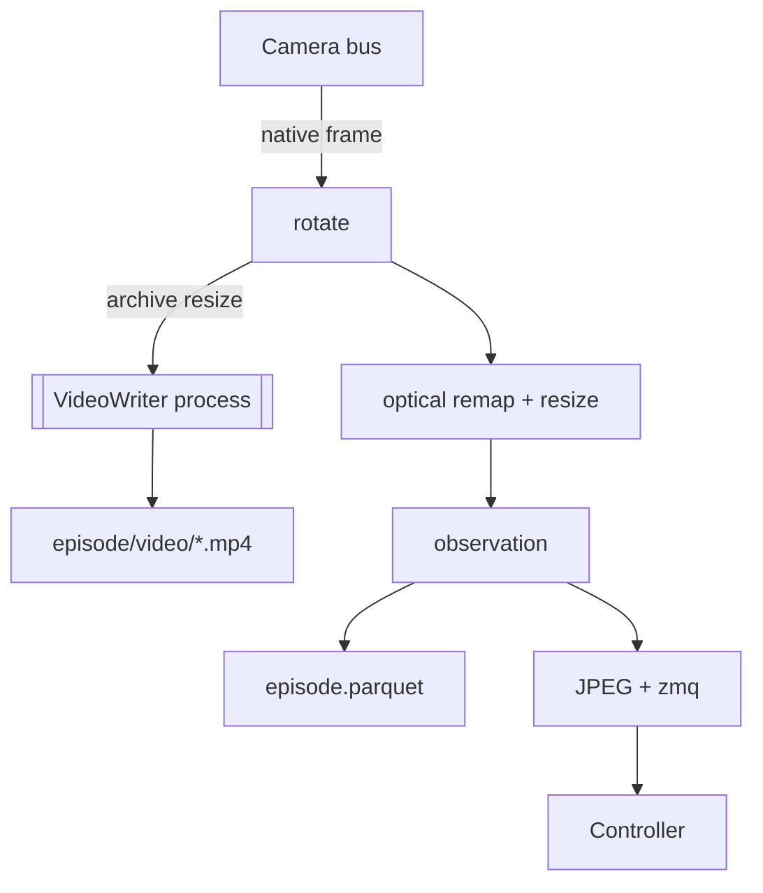

export const metadata = {
  title: 'Recording',
  description:
    'How Solarian records episodes: the robot writes one mp4 per camera at archive resolution and one parquet of every signal at its native rate, and the controller can write the same layout from what reached it, so a dataset keeps the quality the sensor produced and, beside it, what the policy actually saw.',
}

# Recording

A dataset outlives the policy it was collected for. The resolution your policy trains at today is not the resolution you will want in two years, and no amount of later work recovers pixels a downscale threw away — so Solarian records the frame the sensor produced, not the frame the policy consumes. {{ className: 'lead' }}

An episode can record on two sides, each switched on or off by the operator: **the robot**, the high-fidelity record and the only process that ever sees a full-resolution frame, and **the controller**, which records what reached it and the agentic controller's log of the run. Both write the same session layout under the project's `recordings/` folder.

## Why the robot is the high-fidelity side

The observation a controller receives has been downscaled to the policy's input size, optically remapped, and JPEG-compressed — three irreversible losses, applied before the frame leaves the robot. On top of that, every hop of the link is `ZMQ_CONFLATE`: a controller that stalls for a tick does not get a backlog, it gets the latest frame and a hole where the others were. That is the right trade for teleop and the wrong one for a dataset.

So the camera bus tees each captured frame to an encoder process *before* the observation path touches it, and the table is written in the robot's main process from the observations it publishes. Nothing about the dataset depends on the network being up.



## What the controller records

The controller's recording is the other end of the link. Its rows are the observations as they arrived — JPEG-decoded, at the preview rate, after the network — and its actions are the ones it sent, whether or not the robot received them. Its video is the frames it was shown, at the size they arrived. Each row still carries the robot's capture stamp in `obs.<module>.ts`, beside the controller's own receive time in `wall_ts`, so the latency of every row is in the table.

That is the dataset to look at when a policy behaves differently on the robot than in training: it is what the policy saw, holes and all. Beside each episode it keeps a `logs/` directory: every skill and tracker the operator or the [agentic controller](/docs/agentic_controller) started or stopped, what the trackers marked on each frame, and the agent's runs (see [Episode logs](/docs/agentic_controller#episode-logs)). With only the robot recording, none of it is kept.

When both sides record, the controller waits for the robot to open its episode and then files its own under the robot's session directory name and episode index, so the two datasets line up file for file. If the robot cannot record, or does not answer within a few seconds, the controller records on its own numbering and says so.

## On disk

```text
recordings/
├── robot/0003_7f3a9c_cup_stacking/
│   ├── session.json          written at the first episode, then immutable
│   ├── manifest.jsonl        appended and fsynced once per sealed episode
│   └── episodes/000000/
│       ├── episode.json
│       ├── episode.parquet
│       └── video/<module>.<field>.mp4
└── controller/0003_7f3a9c_cup_stacking/
    ├── …                     the same files, from what reached the controller
    └── episodes/000000/logs/    what the operator, the agent and the trackers did
```

A session directory is `<number>_<hash>_<name>`. The number counts up within a recordings root, so sessions sort in the order they were recorded and you can ask for "session 3". The hash tells apart two sessions that reached the same number on different machines once they meet, on upload for instance. The name is the one you gave the session. The directory is created when the session's first episode opens, so a robot that boots and never records leaves nothing behind and spends no number.

<Properties>
  <Property name="session.json" type="written once">
    What makes an episode directory self-describing: column dtypes and units, camera geometry, the optical remap and resize that export has to apply because the archive is stored raw, the Solarian version and the git sha. Also `source` (`robot` or `controller`), and the session's `id` (`<number>_<hash>`), `number` and `name`.
  </Property>
  <Property name="episode.parquet" type="one per episode">
    Every low-dimensional signal — observations, the actions the robot received, and one frame index per camera. Zstd-compressed, written in row groups as the episode runs, so a hard kill costs one row group rather than the episode.
  </Property>
  <Property name="episode.json" type="written at seal">
    Selection metadata: duration, row count, status, task, measured rate per module, per-camera frame count and coverage, and running statistic sums. Enough to choose episodes without opening a parquet file.
  </Property>
  <Property name="manifest.jsonl" type="append-only">
    The durability ledger, fsynced per line. A torn last line costs you one entry instead of the record of what has already been uploaded.
  </Property>
</Properties>

### Why mp4 and parquet rather than one array store

Video and tabular data have nothing in common but the clock. H.264 exploits the fact that consecutive frames are nearly identical, which is worth an order of magnitude over storing frames as independent images in an array store. The low-dimensional side is the opposite case: a few hundred heterogeneous scalar columns with a schema, which is what Parquet is for and what an N-dimensional array store has to be talked into.

### One row per module update, not one row per tick

A table sampled at 30 Hz throws away an arm running at 90 Hz and a gripper at 120 Hz. Solarian writes a row whenever *any* module publishes a new sample, so each signal keeps its own cadence and nothing is resampled until export, when the target rate is finally known. A signal that did not advance carries its previous value forward; the per-module `ts` column is what tells a consumer how stale each one was.

Cameras are the exception: the table stores a frame index and a capture timestamp rather than pixels. The recorder and the encoder both derive that index from the same `(start_time, fps)`, so no index ever crosses a process boundary and a dropped message cannot desynchronise the video from the table.

## Configuring it

Two files, split by who owns the decision. The controller's `conf/controller.yaml` decides *which sides* record, and how the controller stores its own:

```yaml
recording:
  controller: true             # the GUI's two switches, as they start
  robot: true
  root: recordings/controller
  # crf, keyint, preset, ... as in the robot's block below
```

The robot's `conf/robot.yaml` decides *where and how* the robot stores its episodes:

```yaml
recording:
  enabled: true
  root: recordings/robot
  crf: 20        # near-transparent; survives a later re-encode
  keyint: 120    # frames between keyframes; a quality/size/CPU dial
  preset: veryfast
  x264_options:  # applied over the preset
    x264-params: subme=0:me=dia
  threads: 1     # per camera, out of the cores the control loop also wants
  queue_size: 256  # captures the encoder may fall behind by
  max_session_gb: 64.0
```

`keyint` is not about random access, whatever the usual advice says: nothing seeks an archive, because the export decodes each one start to finish. It is a quality dial. Every keyframe is a fresh anchor that the frames after it drift away from, so shortening the gap raises quality at a fixed `crf` — on wrist-camera footage, 30 holds about 4 dB more luma PSNR than 120. It also bounds what a killed episode loses, since `frag_keyframe` starts a fragment at each keyframe. Both are paid for in size and a little CPU, keyframes being the bulky and expensive ones. Going from 30 to 120 gave back a tenth of the encode and a third of the file for that 4 dB, which is worth it while the archive stays well clear of the `crf 23` the export re-encodes to.

`x264_options` goes straight to libx264, over the top of whatever `preset` chose. Reach for it before reaching for a faster preset: a preset moves a dozen settings at once, and usually only one of them is paying for itself. Here that one is motion estimation. `subme=0:me=dia` coarsens the search for an eighth of the encode cost, 0.1 dB, and no extra bytes — `crf` spends bits to the same quality whichever search found the match, and this scene gains nothing from the finer one. Dropping to `superfast` saves the same CPU and doubles the file.

`queue_size` is worth more thought than it looks. An encoder's cost tracks how much the scene is moving — on a Pi 5 the bitrate of a take and the rate the robot samples its own signals correlate at about −0.95 — so a busy stretch puts it over budget for a few seconds at a time. The encoder therefore runs at a lower scheduler priority than the camera and the control loop: it is the only consumer that can afford to wait, because it has a queue, whereas a frame the camera never captured is gone. The queue is the room it has to fall behind in and catch up afterwards, and it costs `width * height * 3` bytes a slot — at 1014x760 that is 2.3 MB, so 256 slots is 8 seconds of slack for 590 MB.

Coverage — the fraction of grid slots backed by a distinct capture — is as much a statement about the clock as about the camera. Each slot keeps the first capture that lands in it and discards the rest, so what matters is not only that a frame arrived but that it is dated correctly. Date it on arrival and the scheduler's jitter decides: on a loaded Pi 5 the gap between consecutive arrival stamps ranged from 12 to 50 ms against a 33 ms interval, putting 18% of captures into a slot already taken and costing that much coverage while the camera had missed nothing at all. Where the hardware timestamps its own frames the bus uses that instead, which is exact and evenly spaced; libcamera reports `SensorTimestamp`, and with it the same test records every frame. `receive_latency` remains the fallback for cameras that cannot say, and being a constant it can correct the average delay but never the jitter.

Recording is on by default, because a teleop session that was not recorded cannot be recovered and the cost of an mp4 nobody wanted is a deletion. `max_session_gb` is the counterweight: on-by-default without a cap fills an SD card.

`root` has to be a disk on the machine running the robot. A relative path resolves against the project folder (`SOLARIAN_PROJECT_PATH`, else the working directory), which keeps the recordings with the project that made them. That is the right default only while the project is local — if the project is a network mount, the default puts the link in the encoder's path, and the encoder is already the tightest budget on a single-board computer. Point `root` at local storage and let the transfer step move episodes afterwards.

Archive resolution is per camera, in the camera's own config:

```yaml
sensors:
  camera:
    width: 2028          # what the sensor is opened at
    height: 1520
    resize_width: 1014   # what the observation carries
    resize_height: 760
    archive_width: 1014  # what is recorded
    archive_height: 760
```

Leave `archive_*` unset to record at the sensor's full resolution. It exists because a Raspberry Pi 5 has no hardware H.264 encoder, so the archive size is bounded by what software x264 keeps up with — measure before raising it.

On a Raspberry Pi CSI camera, setting `archive_*` equal to `resize_*` at the sensor's aspect also moves the downscale off the CPU: the ISP delivers frames at that size from the full-size sensor mode, so the view is the same and there is a quarter of each frame to copy out of the camera's buffer. On a Pi 5 off 2028x1520 that saves about 5 ms a frame.

Prefer a size that divides the sensor by a whole number. `cv2.resize` with `INTER_AREA` only takes its fast path at integer ratios, and the difference is not subtle: on a Pi 5, 2028x1520 down to 1014x760 costs 1.5 ms, while 1332x1000 — a 1.523 ratio, only 42% more pixels — costs 33.6 ms, which is a whole core at 30 fps. Re-encoding real wrist-camera footage on a Pi 5, the encoder itself costs 0.51 of a core at 1014x760 and 0.97 at 1332x1000. Skipping the resize entirely and archiving the native 2028x1520 is the worst of both: 2.88 cores, because the 1.5 ms of resize you save buys you seventy of encoding.

## Recording a session

`solarian run-controller` starts idle. Press `r` to open an episode and `r` again to seal it, `delete` to throw the current one away and re-record it.

The **Recording** panel, at the top of the pygame window and on the web controller page, has a switch per side. A switch decides where the *next* episode records: flip one mid-take and the take in progress still seals on the sides it started on. The status line says which sides are recording now, or between takes which ones are armed.

To open the first episode as soon as the session is up, set `record: true` in the controller's config. That is a different switch from the robot's `recording.enabled`, and the two answer different questions: `recording.enabled` is whether the robot can record at all, while `record` is only whether an operator has to press a key first. `solarian record` ignores `record` either way, since it opens and seals every episode itself.

For a deliberate collection run, `solarian record` cuts the same teleop loop into episodes:

```bash
solarian record num_episodes=50 episode_time_s=20 name=cup_stacking
```

```yaml
# conf/commands/record.yaml — only the shape of the session
name: cup_stacking
num_episodes: 50
episode_time_s: 30.0   # null records until you press r or delete
reset_time_s: 5
reset_period: 1
tasks: []              # one episode per task, cycled
```

The controller keeps teleoperating between episodes as much as during them, so you reset the scene by hand and nothing is torn down and rebuilt between takes. Pressing `delete` reuses the episode index, so a bad take leaves no gap in the dataset.

`name` names the session directory; a number and a hash are put in front of it, so a rerun gets its own directory rather than mixing its episodes in with ones an older build wrote. `solarian record` refuses to start when both switches are off, and when the robot's switch is on but the robot has recording disabled, because finding out after fifty takes is too late.

<Note>
  An episode boundary is the one action that must not be dropped — a lost `RECORD_STOP` leaves the next take appended to this one. The controller therefore resends a boundary every tick until the robot echoes the request id back in its observation, and gives up loudly after three seconds rather than silently corrupting an episode.
</Note>

## Exporting a training set

A session is not a training set, deliberately. Export is where the irreversible choices are finally made — a target rate, a policy resolution, a warped image — and because the session never changes, they are all cheap to redo.

```bash
solarian export-dataset recordings/robot/0003_7f3a9c_cup_stacking
```

A controller session exports the same way, from `recordings/controller/`.

That writes a [LeRobot](https://github.com/huggingface/lerobot) v2.1 dataset, which is what `solarian train` reads:

```text
lerobot/
├── meta/{info.json,episodes.jsonl,episodes_stats.jsonl,tasks.jsonl}
├── data/chunk-000/episode_000000.parquet
└── videos/chunk-000/observation.images.<camera>/episode_000000.mp4
```

Solarian Base also opens the session itself, and a UMI replay buffer. See [Dataset formats](/docs/datasets).

Two things happen on the way. Every signal is resampled onto one grid by sample-and-hold, because LeRobot's contract is that row *i* is the state at `i / fps` — and holding the last reported value is the only resampling that cannot invent a reading the robot never produced. And every frame is warped through the camera's optical remap and downscaled to `resize_width`/`resize_height`, which is the step the robot skipped on purpose.

Recalibrate a camera and re-export, and past datasets pick up the new geometry. Decide the policy wants a different rate, or a resolution the archive can still supply, and re-export. Pass `--no-remap` to keep the archive geometry untouched, which is what a re-calibration or a higher-resolution experiment wants.

Episodes whose video did not seal are marked `video_failed` at record time and skipped here. An encoder that cannot keep up is a recording problem, and silently exporting a table whose frame indices point at frames that were never written would turn it into a training problem.
