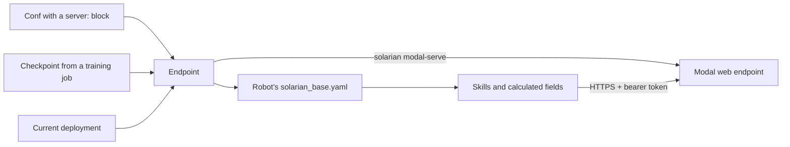

export const metadata = {
  title: 'Services, Policies & Models',
  description:
    'Run the services and policies of a solarian project on Solarian Base GPUs, serve the checkpoints Base training jobs wrote, and point the robot at them through its connection file.',
}


# Services, policies & models

Base runs the servers a project's skills and calculated fields call, such as a
SAM 2 tracker or a diffusion policy, as endpoints on [Modal](https://modal.com)
GPUs at stable URLs. **Models** lists the checkpoints your training jobs wrote,
ready to serve. The robot's connection file points the project's confs at the
endpoints, so nothing in a skill changes. {{ className: 'lead' }}



## What Base can serve

A **servable** is a conf in `conf/services/` or `conf/skills/` with a
`server:` block, the same block `solarian run-service` reads (see
[Services](/docs/services)). Its URL key must be a deployment key: Base writes
the endpoint's URL under it.

```yaml
# conf/services/bbox_tracker.yaml
server_url: ${deployment.bbox_tracker_url}           # the URL key: bbox_tracker_url
token: ${oc.select:deployment.solarian_base_endpoint_token,null}
server:
  service: sam2-tracker
  port: 8765
  args: [--model, small]
```

A servable whose service takes a checkpoint is a **policy**; the others are
**services**. A skill conf reads `policy_server_url` and `policy_server_token`
instead of `server_url` and `token`.

`solarian base manifest` lists what a deployment of the directory would serve,
with the reason for any it cannot: no `server.service`, a service that is not
installed, or a URL that is not a `${deployment.*}` key.

```
serve   bbox_tracker: service sam2-tracker -> bbox_tracker_url
serve   umi_target: policy diffusion-policy -> umi_target_policy_server_url
```

## Start an endpoint

**From the CLI:**

```bash
solarian base endpoints start bbox_tracker
solarian base endpoints start umi_target --checkpoint 1a2b3c4d --min-containers 1
solarian base endpoints start bbox_tracker -- --model large     # extra server args
```

`start` deploys first when the code changed, then prints the deploy's output
until the endpoint is up, with the URL it serves at.

| Flag | Effect |
| --- | --- |
| `--checkpoint JOB[:PATH]` | For a policy: a training job's id or prefix, and optionally the file. Default: its `latest.ckpt` |
| `--gpu-type T` | `T4` (the default), `L4`, `A10G`, `L40S`, `A100-40GB`, `A100-80GB`, `H100`, or `none` for CPU |
| `--min-containers N` | Containers kept warm; 0 (the default) scales to zero |
| `--scaledown S` | Seconds idle before scaling to zero (default 300) |
| `--no-deploy` | Use the current deployment as it is |
| `--no-wait` | Return once the endpoint is queued |
| `-m`, `--message` | Message for the deployment it makes |
| `-- ARGS` | Appended to the conf's `server.args` |

**From the web app:** **Services & Policies → Run a service or policy**: pick
the project, the deployment (the current one by default), the servable, and for
a policy the checkpoint, then the GPU and **Keep one container warm**.

## What an endpoint runs

Base runs `solarian modal-serve <servable>` inside the deployment, as a
training job runs `solarian modal-train`, with:

- the project's [environment variables](/docs/solarian-base/deployments#secrets), such as `HF_TOKEN`, in the container;
- the project's endpoint token as `SOLARIAN_ENDPOINT_TOKEN`, so the server
  answers only requests that carry it;
- Base's Modal account and the organization's volume at `/data`, where training
  jobs write checkpoints: a policy loads its checkpoint in place, without a copy;
- `HF_HOME`, `TORCH_HOME` and the server's working directory under
  `/data/cache`, so weights a server downloads on first start survive cold starts.

The server itself runs unchanged, as `python -m <server_module>`, in the image
its service declares (a policy's is the image its trainer trained in) or one
derived from the server package's requirements.

## URLs, replacing and stopping

Each project has one URL per URL key, so serving another checkpoint with
`umi_target`, or redeploying `bbox_tracker` with new code, keeps the URL the robot
already has. The new endpoint replaces the old one once it is up; until then the
old one keeps answering, and if the new one fails, it stays. Only one endpoint
per URL key can be starting at a time.

An endpoint's details (click its row) show the URL, the key it is written under
in the connection file, the servable and checkpoint, and the deploy's output:

- **Stop** takes it down; calls to its URL fail until something serves that key again.
- **Redeploy**, or **Start again** for a stopped one, serves the same servable on
  the project's current deployment.
- **Container logs** fetches the server's last log lines from Modal.
- **Check health** calls the server's `/health` once.

```bash
solarian base endpoints ls                # this project's endpoints
solarian base endpoints ls --all --status stopped,failed
solarian base endpoints logs ENDPOINT_ID
solarian base endpoints stop ENDPOINT_ID
```

Base checks every 30 seconds that a running endpoint's Modal app still exists.
It never calls `/health` on its own, since that would start a GPU for an
endpoint scaled to zero.

<Note>
  A call to an endpoint scaled to zero waits for a container to start and load
  the model: tens of seconds for SAM 2, more for a large policy. Keep one
  container warm for a session on the robot, with the GPU billed while idle, or
  raise the skill's `connect_retries` so it waits.
</Note>

## Models

**Models** lists every checkpoint your training jobs wrote, newest job first,
with its job, run, datasets, size and the endpoints serving it. **Serve** opens
the start dialog with the checkpoint chosen and the project's first policy
servable.

```bash
solarian base models ls          # this project's checkpoints
solarian base models ls --all    # every project's
```

Base serves only checkpoints its own training jobs wrote, since those are on the
volume the endpoint mounts. To serve a checkpoint from elsewhere, run
`solarian modal-serve` with your own Modal account, or `solarian run-service`
on your own GPU.

## Point the robot at the endpoints

The robot's `conf/deployment/solarian_base.yaml`, from **Download
solarian_base.yaml** on its page, carries the URL of each running endpoint of
its project under its URL key, and the token they require:

```yaml
extends: turing
bbox_tracker_url: 'https://acme--sb-1a2b3c4d5e6f-bbox-tracker-url.modal.run'
umi_target_policy_server_url: 'https://acme--sb-1a2b3c4d5e6f-umi-target-policy-server-url.modal.run'
solarian_base_endpoint_token: '...'
```

- **Extends** names the profile the file adds to: the project's own
  device paths, ports and placement keys.
- **Include the managed relay** adds Base's relay. Uncheck it for a robot
  that keeps its own relay and controller and uses Base only for GPUs; the
  file then carries only the endpoints, and downloading it issues no robot token.

Download the file again after starting or stopping an endpoint. Run every host
with `-d solarian_base`, so they agree on the URLs and on where each field and
skill runs. A Base controller session gets the endpoints in its own deployment
file when it starts.

The token is the project's, the same for all its endpoints. Treat the file as a
credential and keep it out of version control.

## See also

- [Services](/docs/services) — the `server:` block, `run-service`, and writing a service or policy server.
- [Quick Start](/docs/solarian-base/quickstart) — serve a checkpoint and a service, and use them from the robot.
- [Robots & Controller](/docs/solarian-base/robots) — the connection file and the managed relay.
- [Training & Runs](/docs/solarian-base/training) — the jobs whose checkpoints **Models** lists.
