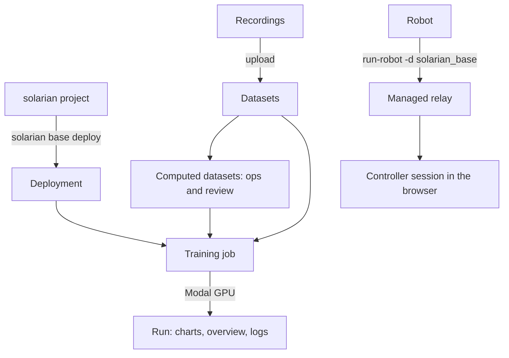

export const metadata = {
  title: 'Solarian Base',
  description:
    'Solarian Base hosts what a solarian project needs beyond the robot: datasets, deployments, cloud training with experiment tracking, and robot sessions in the browser.',
}

# Solarian Base

solarian is to Solarian Base what Next.js is to Vercel. You build a project
with solarian; Base stores its datasets, deploys its code, trains it on cloud
GPUs, tracks every run, and lets you drive its robots from a browser. Most
actions work from the `solarian base` CLI and from the web app alike. {{ className: 'lead' }}

New to Base? Follow the [Quick Start](/docs/solarian-base/quickstart): it takes
one project from a deployment to a trained model and a robot driven from the
browser.

## What you can do, and where

| Capability | CLI | Web app |
| --- | --- | --- |
| Log in, API tokens | `solarian base login`, `logout`, `whoami` | **Settings → API tokens** |
| Projects | `solarian base link --create` | **Projects** |
| Upload and view datasets | Not available yet | **Projects → New Dataset**, **Datasets** |
| Computed datasets, ops, review | Not available yet (`solarian dataset` works on local copies) | A dataset's **Versions** |
| Deploy a project | `solarian base deploy`, `manifest` | Project → **Deployments** |
| Project secrets | `solarian base env` | Project → **Environment variables** |
| Train on cloud GPUs | `solarian base train` | **Start training** |
| Follow runs | `solarian base runs` | **Runs** |
| Robots, relays, controller sessions | Not available yet, except `solarian run-robot` on the robot | **Robots** |
| Hosted services and policy servers | Not available yet | Not available yet |

Every capability is also in the REST API. The interactive reference is at
`/api/docs/` on your Base, and the schema at `/api/schema/`.

## Concepts

<Properties>
  <Property name="Project">
    The unit everything else belongs to: datasets, deployments, training jobs,
    runs and robots. A solarian project on disk links to one with
    `solarian base link`.
  </Property>
  <Property name="Dataset">
    An uploaded recording in LeRobot, UMI (Zarr) or Solarian format. Uploaded
    datasets never change.
  </Property>
  <Property name="Computed dataset">
    A tree of versions over an uploaded Solarian dataset, each one an op
    applied to its parent: mirror, merge, split, track, delete episodes.
  </Property>
  <Property name="Deployment">
    An immutable snapshot of the project's code, with the trainers and train
    configs it contains. Training jobs run against one.
  </Property>
  <Property name="Training job">
    One run of `solarian modal-train` on a cloud GPU, launched by Base from a
    train config of the project or from a stock trainer.
  </Property>
  <Property name="Run">
    The experiment record of a training: metrics history, console logs, tags,
    notes and a summary. A job opens one; so does any training that logs with
    the `solarian_base` backend.
  </Property>
  <Property name="Robot">
    A physical robot registered in a project. Base hosts a relay for it, so it
    can be driven from a controller session in the browser.
  </Property>
</Properties>

## Where to go next

- [Quick Start](/docs/solarian-base/quickstart) — deploy, train and run a robot, end to end.
- [Getting Started](/docs/solarian-base/getting-started) — account, CLI login, linking a project, API tokens.
- [Projects & Datasets](/docs/solarian-base/projects-and-datasets) — uploads, the viewer, computed datasets and review.
- [Deployments & Secrets](/docs/solarian-base/deployments) — shipping code and environment variables.
- [Training & Runs](/docs/solarian-base/training) — cloud training jobs and the runs they log.
- [Robots & Controller](/docs/solarian-base/robots) — connecting a robot, the managed relay and controller sessions.
- [CLI Reference](/docs/solarian-base/cli) — every `solarian base` command and flag.
- [Self-hosting](/docs/solarian-base/self-hosting) — running Base on your own machine.
