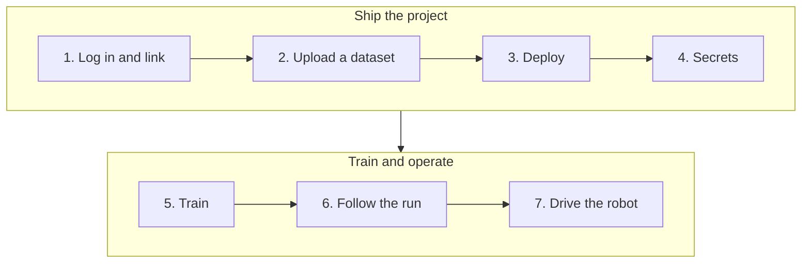

export const metadata = {
  title: 'Solarian Base Quick Start',
  description:
    'Take a solarian project from a Base deployment to a trained model and a robot driven from the browser, with the CLI and the web app.',
}


# Quick start

This walks one solarian project through Base: deploy it, train it on a cloud
GPU against an uploaded dataset, follow the run, then connect the robot and
drive it from the browser. Each step shows the CLI and the web app; use either. {{ className: 'lead' }}



You need a solarian project with a training file (here `conf/training/umi.yaml`,
which `solarian install solarian-umi-skill` seeds; see
[Training](/docs/training)), a recording to train on, and a Base to log in to. To run Base on your own machine, see
[Self-hosting](/docs/solarian-base/self-hosting).

## 1. Log in and link the project

```bash
pip install solarian-base
solarian base login            # approve the code in the browser
cd myrobot
solarian base link --create    # creates the Base project "myrobot"
```

**You should see** `Linked .../myrobot to myrobot (...)`, and
`solarian base whoami` names you and the project.
[More on logging in and tokens](/docs/solarian-base/getting-started).

## 2. Upload a dataset

**From the web app:** **Projects → myrobot → New Dataset → Upload**, pick the
archive (`.zarr.zip` for UMI, `.zip` for LeRobot, `.solarian.zip` for a solarian
session), name it, and press **Upload Dataset**.

<Note>Web app only: there is no CLI upload yet.</Note>

**You should see** the dataset page, with every camera playing in sync with the
action charts. Its id is in the address: `/datasets/3f2a9c1e-...`. Copy it for
step 5. [More on datasets](/docs/solarian-base/projects-and-datasets).

## 3. Deploy

**From the CLI:**

```bash
solarian base deploy -m "first deploy"
```

**From the web app:** **Projects → myrobot → Deployments → Import from git**,
with the repository URL and a branch or tag.

**You should see** the deployment become `ready` and `current`, with
`umi` among its train configs (**Details** on the project page, or
`solarian base manifest` before deploying).
[More on deployments](/docs/solarian-base/deployments).

## 4. Add secrets, if the trainer needs any

**From the CLI:**

```bash
solarian base env add HF_TOKEN       # prompts for the value
```

**From the web app:** **Projects → myrobot → Environment variables**.

Every training job of the project gets them from then on.

## 5. Train

**From the CLI:**

```bash
solarian base train umi --dataset task.dataset_mix.0.path=3f2a9c1e training.num_epochs=4
```

**From the web app:** **Start training** on the project page, or on the
dataset page to preselect it. Pick **A train config of this project**, choose
`umi`, set the dataset for `task.dataset_mix.0.path`, and start.

**You should see** the launcher's output while Modal builds the image, then the
training's own console output. Ctrl-C stops following; the job keeps running.
[More on training](/docs/solarian-base/training).

## 6. Follow the run

**From the CLI:**

```bash
solarian base runs ls
solarian base runs show 1a2b3c4d      # state, summary, the job and its checkpoints
solarian base runs logs -f 1a2b3c4d
```

**From the web app:** **Runs → (the run)**, with **Charts**, **Overview** and
**Logs**.

**You should see** the run `finished`, its loss curves, and the checkpoints
under **Launched by** in the overview.

## 7. Drive the robot from the browser

**From the web app:**

1. **Robots → Register Robot**: choose the project, a name and the control rate.
2. On the robot's page, **Allow cloud control of this robot**, then **Start**
   under **Managed relay**.
3. Under **Connect this robot**, **Download solarian_base.yaml** and save it
   on the robot as `conf/deployment/solarian_base.yaml`.
4. On the robot:

   ```bash
   solarian run-robot -d solarian_base
   ```

5. Once the robot shows `online`, press **Open Controller**, then **Take
   control**. **STOP ALL** halts the robot; **End session** closes it.

<Note>
  Web app only, apart from `solarian run-robot` on the robot itself: there are
  no `solarian base` commands for robots yet.
</Note>

**You should see** the robot's cameras and state live in the controller page.
[More on robots and controller sessions](/docs/solarian-base/robots).

## Next steps

- [Projects & Datasets](/docs/solarian-base/projects-and-datasets) — curate data with computed datasets and review sessions before training.
- [Training & Runs](/docs/solarian-base/training) — stock trainers, GPUs, dataset references and cancelling jobs.
- [Experiment tracking](/docs/tracking) — log any training to Base, or to wandb as well.
- [CLI Reference](/docs/solarian-base/cli) — every command, and `--json` for scripts and agents.
