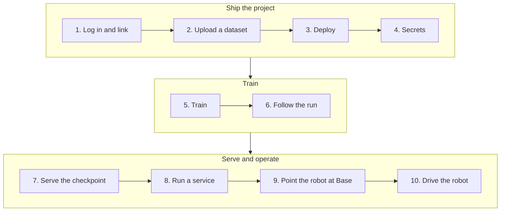

export const metadata = {
  title: 'Solarian Base Quick Start',
  description:
    'Take a solarian project from a Base deployment to a trained model, serve it and its services on Base, and use them from the robot, with the CLI and the web app.',
}


# Quick start

This walks one solarian project through Base: deploy it, train it on a cloud
GPU against an uploaded dataset, follow the run, serve the checkpoint and the
services its skills call, point the robot at them, and drive it from the
browser. Each step shows the CLI and the web app; use either. {{ className: 'lead' }}



You need a solarian project with a training file (here `conf/training/umi.yaml`,
which `solarian install solarian-umi` seeds; see
[Training](/docs/training)), a recording to train on, and a Base to log in to. To run Base on your own machine, see
[Self-hosting](/docs/solarian-base/self-hosting).

Steps 7 to 9 use a point-and-pick skill: `conf/skills/umi_target.yaml`, a
`UMISkill` whose diffusion policy picks the object a SAM 2 tracker boxes
(`conf/services/bbox_tracker.yaml`). Any conf with a `server:`
block works the same way; see [Services](/docs/services).

## 1. Log in and link the project

```bash
pip install solarian-base
solarian base login            # approve the code in the browser
cd myrobot
solarian base link --create    # creates the Base project "myrobot"
```

**You should see** `Linked .../myrobot to myrobot (...)`, and
`solarian base whoami` names you and the project.
[More on logging in and tokens](/docs/solarian-base/getting-started).

## 2. Upload a dataset

**From the web app:** **Projects → myrobot → New Dataset → Upload**, pick the
archive (`.zarr.zip` for UMI, `.zip` for LeRobot, `.solarian.zip` for a solarian
session), name it, and press **Upload Dataset**.

<Note>Web app only: there is no CLI upload yet.</Note>

**You should see** the dataset page, with every camera playing in sync with the
action charts. Its id is in the address: `/datasets/3f2a9c1e-...`. Copy it for
step 5. [More on datasets](/docs/solarian-base/projects-and-datasets).

## 3. Deploy

**From the CLI:**

```bash
solarian base deploy -m "first deploy"
```

**From the web app:** **Projects → myrobot → Deployments → Import from git**,
with the repository URL and a branch or tag.

**You should see** the deployment become `ready` and `current`, with
`umi` among its train configs (**Details** on the project page, or
`solarian base manifest` before deploying). A project with a
`conf/robot.yaml` also gets its robot, named after the project, under
**Robots**: the build log ends with `Robot 'myrobot' registered` and the link
to its page.
[More on deployments](/docs/solarian-base/deployments).

## 4. Add secrets, if the trainer needs any

**From the CLI:**

```bash
solarian base env add HF_TOKEN       # prompts for the value
```

**From the web app:** **Projects → myrobot → Environment variables**.

Every training job of the project gets them from then on.

## 5. Train

**From the CLI:**

```bash
solarian base train umi --dataset task.dataset_mix.0.path=3f2a9c1e training.num_epochs=4
```

**From the web app:** **Start training** on the project page, or on the
dataset page to preselect it. Pick **A train config of this project**, choose
`umi`, set the dataset for `task.dataset_mix.0.path`, and start.

**You should see** the launcher's output while Modal builds the image, then the
training's own console output. Ctrl-C stops following; the job keeps running.
[More on training](/docs/solarian-base/training).

## 6. Follow the run

**From the CLI:**

```bash
solarian base runs ls
solarian base runs show 1a2b3c4d      # state, summary, the job and its checkpoints
solarian base runs logs -f 1a2b3c4d
```

**From the web app:** **Runs → (the run)**, with **Charts**, **Overview** and
**Logs**.

**You should see** the run `finished`, its loss curves, and the checkpoints
under **Launched by** in the overview.

## 7. Serve the checkpoint

A policy is a [service](/docs/services) that loads a checkpoint. Base serves
the ones its training jobs wrote, with a policy conf of the project: one whose
`server:` block names a service that takes a checkpoint.

```yaml
# conf/skills/umi_target.yaml
policy_server_url: ${deployment.umi_target_policy_server_url}
policy_server_token: ${oc.select:deployment.solarian_base_endpoint_token,null}
server:
  service: diffusion-policy
  checkpoint: ${oc.select:deployment.umi_target_policy_checkpoint,null}
  port: 8003
```

**From the CLI:**

```bash
solarian base models ls                                  # job prefix, size, path
solarian base endpoints start umi_target --checkpoint 1a2b3c4d
```

`--checkpoint` takes the job and, optionally, the file: `1a2b3c4d` serves its
`latest.ckpt`, `1a2b3c4d:/outputs/pick/checkpoints/epoch_0040.ckpt` another one.

**From the web app:** **Models**, then **Serve** on the checkpoint. Pick
`umi_target` as the servable, a GPU, and start.

**You should see** the endpoint `starting` while Modal builds the image (minutes
the first time), then `running` with a URL under **Services & Policies**. The
URL stays the same when you serve another checkpoint with the same conf: the
new endpoint replaces the old one once it is up.

## 8. Run a service

The tracker behind the skill's `bbox` field is served the same way, without a
checkpoint:

```yaml
# conf/services/bbox_tracker.yaml
server_url: ${deployment.bbox_tracker_url}
token: ${oc.select:deployment.solarian_base_endpoint_token,null}
server:
  service: sam2-tracker
  port: 8765
  args: [--model, small]
```

**From the CLI:**

```bash
solarian base endpoints start bbox_tracker
solarian base endpoints ls
```

**From the web app:** **Services & Policies → Run a service or policy**, then
`bbox_tracker`.

**You should see** both endpoints `running`. **Check health** in an endpoint's
details calls its `/health` and shows the answer.

<Note>
  An endpoint scales to zero after five idle minutes, and the next call waits
  for a container to start and load the model: tens of seconds for SAM 2, more
  for a large policy. **Keep one container warm** (`--min-containers 1`) for a
  session on the robot, or raise the skill's `connect_retries` so it waits.
</Note>

## 9. Point the robot at Base

The confs read their URLs from `${deployment.*}` keys, so pointing the project
at Base is a deployment profile: the robot's `conf/deployment/solarian_base.yaml`.
Base writes it with the URL of every running endpoint, under the key its conf
reads, and the token they require.

**From the web app:**

1. Open the robot step 3 registered (**Robots → myrobot**).
2. On the robot's page, under **Connect this robot**, set **Extends** to the
   profile the robot already uses, here `turing`, and **Save**.
3. Uncheck **Include the managed relay** if the robot keeps its own relay and
   controller, as `turing` does; leave it checked to use Base's (step 10).
4. **Download solarian_base.yaml** and save it as
   `conf/deployment/solarian_base.yaml`.

**You should see** a file that adds the endpoints to `turing`:

```yaml
extends: turing
bbox_tracker_url: 'https://acme--sb-1a2b3c4d5e6f-bbox-tracker-url.modal.run'
umi_target_policy_server_url: 'https://acme--sb-1a2b3c4d5e6f-umi-target-policy-server-url.modal.run'
solarian_base_endpoint_token: '...'
```

Use `-d solarian_base` wherever you used `-d turing`, so every host reads the
same URLs and placement:

```bash
solarian run-server -d solarian_base        # on the relay host, if you run your own
solarian run-robot -d solarian_base         # on the robot
solarian run-controller -d solarian_base    # on the controller
```

Then start the skill from the controller and click the object in the wrist
camera. The tracker boxes it on Base, and the skill sends each observation to
the policy on Base. Nothing in the skill or the confs changed: only the
deployment keys did. Stop an endpoint, or start one, and download the file
again.

<Note>
  The file carries a credential. Keep `conf/deployment/solarian_base.yaml` out
  of version control.
</Note>

## 10. Drive the robot from the browser

**From the web app:**

1. Open the robot (**Robots → myrobot**).
2. On the robot's page, **Allow cloud control of this robot**, then **Start**
   under **Managed relay**.
3. Under **Connect this robot**, with **Include the managed relay** checked,
   **Download solarian_base.yaml** and save it on the robot as
   `conf/deployment/solarian_base.yaml`. It carries the relay as well as the
   endpoints.
4. On the robot:

   ```bash
   solarian run-robot -d solarian_base
   ```

5. Once the robot shows `online`, press **Open Controller**, then **Take
   control**. **STOP ALL** halts the robot; **End session** closes it.

<Note>
  Web app only, apart from `solarian run-robot` on the robot itself: there are
  no `solarian base` commands for robots yet.
</Note>

**You should see** the robot's cameras and state live in the controller page.
[More on robots and controller sessions](/docs/solarian-base/robots).

## Next steps

- [Projects & Datasets](/docs/solarian-base/projects-and-datasets) — curate data with computed datasets and review sessions before training.
- [Training & Runs](/docs/solarian-base/training) — stock trainers, GPUs, dataset references and cancelling jobs.
- [Services, Policies & Models](/docs/solarian-base/endpoints) — GPUs, keep-warm, replacing and stopping endpoints, and the token.
- [Experiment tracking](/docs/tracking) — log any training to Base, or to wandb as well.
- [CLI Reference](/docs/solarian-base/cli) — every command, and `--json` for scripts and agents.
