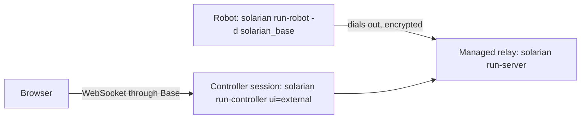

export const metadata = {
  title: 'Robots & Controller',
  description:
    'Connect a robot to Solarian Base, let Base host its relay server, and drive it from a controller session in the browser, with teleop devices.',
}


# Robots & controller

Base can host the two nodes of a solarian system that do not have to be on the
robot: the [server](/docs/servers), as a managed relay, and the
[controller](/docs/controllers), as a session you drive from the browser. The
robot dials out to Base, so nothing has to be reachable at its end. {{ className: 'lead' }}



<Note>
  Robots, relays and controller sessions are mostly web app for now:
  `solarian base deploy` registers the robot, and `solarian run-robot` runs on
  the robot itself.
</Note>

## Register a robot

**From the CLI:** `solarian base deploy`. A project with a `conf/robot.yaml`
registers its robot when a deployment becomes current: named after the project,
at the conf's `fps`. Later deployments keep that robot, and its keys, and only
update its control rate.

**From the web app:** **Robots → Register Robot**, with its **Project**,
**Name** and **Control rate**, for a project you do not deploy. A deployment
keeps a robot registered this way instead of adding another.

Registering provisions the robot's relay: a block of five ports and a pair of
encryption keys. It does not let anyone command the robot yet.

## Connect it

On the robot's page, under **Connect this robot**, press **Download
solarian_base.yaml**. The file carries the relay's address, its port block, the
robot's keypair and a fresh token. Save it in the robot's solarian project and
start the robot with it:

```bash
# on the robot, in its solarian project
cp ~/Downloads/solarian_base.yaml conf/deployment/solarian_base.yaml
solarian run-robot -d solarian_base
```

`solarian_base` is a [deployment profile](/docs/project-configs) like any
other: it extends one of the project's profiles with Base's relay and keys. The
robot shows `online` while the relay has heard from it within the last 10
seconds.

Each download issues a new token; earlier ones keep working until you revoke
them under **Tokens**.

### What the file extends and carries

- **Extends** is the profile the file adds to, `localhost` by default: where the
  robot's device paths, ports and placement keys come from. Set it to the
  profile the robot already runs with, such as `turing`, and **Save**.
- The file carries the URL of every running [service and
  policy](/docs/solarian-base/endpoints) of the project, under the deployment
  key its conf reads, and `solarian_base_endpoint_token`, the token they
  require. **Services and policies in the file** lists them. Download the file
  again after starting or stopping one.
- **Include the managed relay** is on by default. Turn it off for a robot that
  keeps its own relay and controller and uses Base only for GPUs: the file then
  carries only the endpoints, and the download issues no token.

## Allow cloud control

**Allow cloud control of this robot** is off by default, and controller
sessions refuse to start without it. **Turn off cloud control** takes it back.

If the link to Base drops, the robot stops its skills and holds every module in
its safe state after the robot's link timeout. Your local kill switch is
stopping the robot process. One internet round trip of latency is noticeable
for fine manipulation: skills schedule waypoints ahead to absorb it, so for
that work run the server and controller on your own network instead.

## The managed relay

The **Managed relay** section runs `solarian run-server` for this robot on
Base. It is the clock authority for both sides, so it has to be up before the
robot or a controller can do anything.

- **Start** and **Stop** the relay; its badge shows `pending`, `starting`,
  `running`, `stopped` or `error`, with the error message.
- **Host** and **Ports** are what the robot dials; **Robot last seen** and
  **Health checked** come from Base's probe every 30 seconds.
- **Encryption keys → Rotate** issues a new robot keypair. Every connection
  file downloaded before stops working; download a new one.

## Open a controller session

With the robot `online`, the relay running and cloud control allowed, press
**Open Controller**. Base starts `solarian run-controller ui=external` against
the relay and opens the session page (`/controller/<id>`):

- **Take control** to send commands; **Release control** hands it back. Others
  who open the session watch until you release it.
- **STOP ALL** stops the robot. Anyone in the session can press it, with or
  without control; Space stops it too.
- The cameras, state and skills of the robot, live, and the **Keys** panel.
- **Teleop device** pairs a device in this browser to drive the robot.
- **End session** stops the controller.

Opening the controller again while your session is active returns to it.

### Teleop devices

Under **Teleop devices** on the robot's page, calibrate the leader arms you
drive it with, so their joints match the robot's: **Leader arm (Dynamixel)**,
**Leader arm (Feetech STS)**, with **Calibrate** or **Recalibrate**. They
connect over Web Serial, in Chromium-based browsers. A **SpaceMouse** or a
**Gamepad** pairs itself in the controller and needs no calibration.

## Robot tokens

**Tokens** on the robot's page lists the robot's install tokens with their
**Prefix** and **Last used**. **New token → Issue** creates one, shown once;
**Revoke** disables it.

## Limits

Controller sessions count against your plan:

| Plan | Concurrent sessions | Session minutes per month | Log retention |
| --- | --- | --- | --- |
| Free | 1 | 600 | 7 days |
| Pro | 3 | Unlimited | 90 days |
| Enterprise | 25 | Unlimited | 730 days |

## Servers and services

What Base runs for you, and what you still run yourself:

| Process | On Base | Yourself |
| --- | --- | --- |
| Server (`solarian run-server`) | The managed relay, one per robot | `solarian run-server`, on your network |
| Controller (`solarian run-controller`) | A controller session, from **Open Controller** | `solarian run-controller` |
| Robot (`solarian run-robot`) | Never: it runs on the robot | `solarian run-robot -d solarian_base` |
| Services and policy servers (`solarian run-service`) | An endpoint on a Modal GPU, from **Services & Policies** or **Models** | `solarian run-service <conf>` |

An endpoint's URL reaches the robot through the connection file, so a skill or
calculated field calls it with no change. See
[Services, Policies & Models](/docs/solarian-base/endpoints).

## See also

- [Server](/docs/servers), [Controller](/docs/controllers), [Robot](/docs/robots) — the three nodes.
- [Configs](/docs/project-configs) — deployment profiles such as `solarian_base`.
- [Quick Start](/docs/solarian-base/quickstart) — connecting a robot, step by step.
- [Services, Policies & Models](/docs/solarian-base/endpoints) — what the connection file points the project at.
