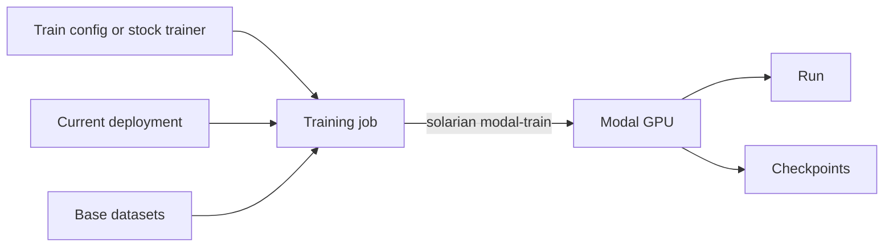

export const metadata = {
  title: 'Training & Runs',
  description:
    'Train a solarian project on cloud GPUs from Solarian Base, with the same train configs as solarian train, and follow every run with charts, an overview and logs.',
}


# Training & runs

A training job runs one of your train configs, or a stock trainer, on a cloud
GPU, against datasets stored in Base. Every job logs to a run: charts, an
overview and the console output. Jobs run on [Modal](https://modal.com), under
Base's own Modal account; you do not need one. {{ className: 'lead' }}



## Start a job

**From the CLI**, with the same config as `solarian train` and `solarian modal-train`:

```bash
solarian base train --conf conf/training/umi_pick_side_boxpool
solarian base train umi_pick_side_boxpool training.num_epochs=4 --gpu-type H100
```

`train` deploys first when the code changed, starts the job, prints the
launcher's output and then follows the run's console output. Ctrl-C stops
following and leaves the job running.

| Flag | Effect |
| --- | --- |
| `--dataset KEY=ID` | Point a config key at a Base dataset (repeatable) |
| `--gpu-type H100`, `--gpus 2` | Override the config's `modal:` block |
| `--no-deploy` | Use the current deployment as it is |
| `--no-follow` | Return once the job is queued |
| `-m`, `--message` | Message for the deployment it makes |
| `--json` | Print the job as JSON |

**From the web app:** **Start training** on the project page, or on a dataset
page to preselect that dataset. The dialog offers two sources:

- **A train config of this project** — one of the current deployment's
  `conf/training/*.yaml`, with Hydra overrides.
- **A stock trainer** — one of the trainers Base ships, such as diffusion and
  LeRobot ACT, configured with a form drawn from its schema. No deployment of
  your own is needed.

Its **GPU** and **GPUs** fields override the config's `modal:` block; left
empty, the config decides.

## Train on Base datasets

A config that names a file on your machine cannot train in the cloud. Point it
at a Base dataset with a `base://` reference:

```bash
solarian base train umi --dataset task.dataset_mix.0.path=3f2a9c1e
# the same as
solarian base train umi "++task.dataset_mix.0.path=base://datasets/3f2a9c1e"
# a version of a computed dataset
solarian base train umi "++task.dataset_mix.0.path=base://datasets/3f2a9c1e@03-mirror"
```

The web app's dialog shows a dataset picker for each path the config reads.
Base checks every path before the GPU starts: one that is neither a Base dataset
nor a file in the deployment fails the job at once, naming the key.

## What a job runs

Base runs `solarian modal-train` inside the deployment, with:

- the project's [environment variables](/docs/solarian-base/deployments#secrets);
- a token scoped to writing this job's run, which expires with the job;
- `SOLARIAN_TRACKING=solarian_base`, so the run reports to Base whatever
  `logging.backend` says, and to wandb as well when the config names it;
- Base's Modal account and one volume per organization, so `modal.profile`,
  `modal.secrets` and `modal.volume` in the config are ignored.

Checkpoints land in `/outputs/<job_name>` on that volume. The job panel and the
run's overview list them, and **Models** lists every job's, with **Serve** to
run one as a policy endpoint; see
[Services, Policies & Models](/docs/solarian-base/endpoints).

## Follow and stop a job

The project page's **Training** section lists its jobs; **Details** opens the
job panel with its state, the GPU, the **Launcher** log and the run. **Cancel
job** stops the GPU and marks the run killed.

<Note>
  There is no `solarian base` command to cancel a job yet: use **Cancel job**
  in the job panel.
</Note>

## Runs

**From the CLI:**

```bash
solarian base runs ls                  # this project's runs
solarian base runs ls --all --state running
solarian base runs show 1a2b3c4d       # state, tags, summary, the job and its checkpoints
solarian base runs logs 1a2b3c4d       # the last 200 console lines
solarian base runs logs -f 1a2b3c4d    # followed live until the run ends
```

**From the web app:** **Runs** lists every run, with filters for tag, group and
state. A run's page has three tabs:

- **Charts** — one chart per metric, grouped by prefix; filter panels with a
  regex and plot against step, epoch or time;
- **Overview** — state, duration, host, GPU, git commit, command, editable
  notes and tags, the config, the summary, and under **Launched by** the job,
  deployment, datasets and checkpoints;
- **Logs** — the console output, searchable, with timestamps.

`solarian_base` is the default logging backend, so a training started on your
own machine with `solarian train` or `solarian modal-train` shows up in **Runs**
too, without a job, once you are logged in and linked. See
[Experiment tracking](/docs/tracking) to log to wandb instead, or to both.

## See also

- [Training](/docs/training) — trainers, train configs and `solarian modal-train`.
- [Experiment tracking](/docs/tracking) — the logging API and its backends.
- [Deployments & Secrets](/docs/solarian-base/deployments) — what a job runs against.
- [Services, Policies & Models](/docs/solarian-base/endpoints) — serve the checkpoints a job wrote.
