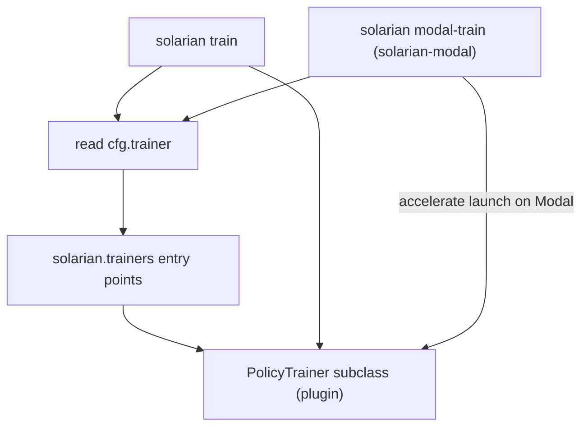

export const metadata = {
  title: 'Training',
  description:
    'Train policies in Solarian via library-agnostic policy plugins: implement a PolicyTrainer, register it under solarian.trainers, and run `solarian train` locally or on Modal.',
}


# Training

Solarian's training is **library-agnostic**. The framework ships only the
generic `solarian train` command plus a small plugin contract; the actual
training logic for a given model family (diffusion, ACT, a VLA, ...) lives in a
**policy plugin**. The same plugin also ships the `PolicyServer` that serves
the trained policy, so a policy is self-contained. {{ className: 'lead' }}



## How `solarian train` works

The command never imports any ML library. It:

1. Reads the `trainer` key from the composed training file.
2. Resolves the matching `PolicyTrainer` subclass through the `solarian.trainers`
   entry-point group.
3. Registers that trainer's `resolvers()`, then resolves the file, so it can use
   interpolations only its trainer defines (`${eval:...}` for UMI).
4. Validates the config with that trainer's `config_class()`.
5. Resolves an `output_dir` (defaults to `$SOLARIAN_PROJECT_PATH/models/<job_name>`).
6. Runs it in this process: `TrainerCls(cfg, output_dir).train()`.

The `solarian-modal` plugin's `solarian modal-train` runs the same config on
Modal; see [Cloud training](#cloud-training-modal).

```bash
solarian train --conf conf/training/cup_arrange
solarian train --conf conf/training/cup_arrange training.num_epochs=10
```

`--conf` names the training file; there is no default. Any key in it can be
overridden on the command line as `key=value`.

## One file per training run

Every run is one complete file in `conf/training/`: which trainer runs it, the
data, the model, the optimizer, the schedule and the tracking. Nothing is
inherited from another file and no value hides in code, so the file is the
whole record of the run.

A trainer plugin ships `templates/training/<name>.yaml`. `solarian install`
copies it to `conf/training/<name>.yaml` once, when that file is not already
there. Copy it per run. `trainer:` stays the trainer's entry-point name, so
several runs share one trainer.

```bash
cp conf/training/umi.yaml conf/training/cup_arrange.yaml
solarian train --conf conf/training/cup_arrange
```

### UMI

`solarian-umi-skill` registers `trainer: umi` and seeds four training files:
`conf/training/umi.yaml` (camera and proprioception, no target),
`conf/training/umi_pick.yaml` (the target box as a 4th image channel),
`conf/training/umi_pick_mask.yaml` (the object's mask, CLS token and
`box_pool`) and `conf/training/umi_place.yaml` (a place point, drawn as a
square on the 4th channel). A target is any `task.shape_meta.obs` entry with
`bbox_mode: mask_channel`, `point_mode: mask_channel` or `type: mask`, read
from the dataset array of the same name (`bbox`, `point` or `mask`, written by
the `track` and `track_point` dataset ops). Each target adds one input channel
to the ViT, so a policy can take several, and a checkpoint with fewer starts
one with more (`training.init_from_ckpt`; the new channel starts at zero).
Each is the UMI training config written as `python train.py`
reads it in the UMI repo, with the task inlined under `task:`, plus four
Solarian keys at the top: `trainer`, `job_name`, `output_dir` and `modal`.
Copy one per run and set:

- `job_name` — checkpoints land in `models/<job_name>/`.
- `task.dataset_mix` — the datasets, `[{path, weight}]`, from `solarian umi-slam`.
- `task.dataset.val_dataset_path`, `training.init_from_ckpt`, `batch_size`,
  `training.num_epochs`, ... — every other value of the run, already written
  out.

Training runs in this process from the UMI code copied into the plugin. It writes
`models/<job_name>/checkpoints/latest.ckpt`. Pair each training file with a
skill yaml copied from `conf/skills/umi.yaml`, and set that file's
`server.checkpoint` to the same path. `solarian run-service cup_arrange` then
serves it, and the same `UMISkill` loads whichever file you name:

```python
self.start_skill(UMISkill(params={"config": "cup_arrange.yaml"}))
```

```text
conf/training/cup_arrange.yaml    job_name: cup_arrange
conf/skills/cup_arrange.yaml      server.checkpoint: models/cup_arrange/checkpoints/latest.ckpt
```

A checkpoint with targets also needs the skill yaml's `targets`, which maps
each to the camera field holding it, such as `{point: target_point}` for a
place policy. `conf/skills/umi_target.yaml` is the template; see
[Skills](/docs/skills#configuration).

The copied training and SLAM code is from
[Universal Manipulation Interface](https://github.com/real-stanford/universal_manipulation_interface),
copyright 2023 Columbia Artificial Intelligence and Robotics Lab, MIT
license. The license text ships beside each copy, as `slam/LICENSE.umi` and `diffusion_policy/LICENSE.umi`.

`solarian umi-slam <session_dir>` turns a directory of GoPro or Lumi collector
MP4s into a dataset, which is a `task.dataset_mix` path above.
ORB-SLAM3 runs in Docker image `chicheng/orb_slam3:latest` and GoPro IMU
extraction in `chicheng/openicc:latest`. An image already on the machine is
used as it is. A missing image is downloaded only after you agree.

The trainer declares a `modal_spec()`, so `solarian modal-train` runs these
configs on Modal too.

## The `PolicyTrainer` contract

Defined in
[`solarian/core/ai/system1/policy_trainer.py`](https://github.com/solarian-dev/solarian/blob/main/solarian/core/ai/system1/policy_trainer.py).
A plugin subclasses it and implements `train()`:

```python
from solarian.core.ai.system1 import PolicyTrainer, ModalSpec

class MyTrainer(PolicyTrainer):
    @classmethod
    def config_class(cls):
        return MyTrainConfig         # a TrainConfig subclass

    @classmethod
    def modal_spec(cls):
        return ModalSpec(pip_packages=["torch", "my-lib"])

    def train(self):
        ...  # the real training loop, using self.cfg and self.output_dir
```

| Member | Purpose |
| --- | --- |
| `train(self)` | **Required.** Runs training to completion. |
| `config_class()` | Pydantic schema validating the config (defaults to the thin `TrainConfig`). |
| `resolvers()` | OmegaConf resolvers the trainer's files may use, registered before they resolve. |
| `modal_spec()` | Declares the container image (apt/pip deps) for cloud training. |
| `add_arguments` / `from_args` / `main` | Standalone CLI launching (e.g. under `accelerate launch`). |

### Thin base config

The framework's `TrainConfig`
([`solarian/core/configs.py`](https://github.com/solarian-dev/solarian/blob/main/solarian/core/configs.py))
only knows common fields — `trainer`, `train_dataset`, `val_dataset`,
`output_dir`, `job_name`, `batch_size`, `steps` and logging — and uses `extra="allow"`, so any plugin-specific keys (model architecture,
optimizer, ...) pass through untouched. A plugin's `config_class()` is a
`TrainConfig` subclass that re-adds and validates those fields.

## Registering a trainer

A policy plugin advertises its trainer under the `solarian.trainers`
entry-point group, and its policy server as a service under `solarian.services`:

```toml
[project.entry-points."solarian.trainers"]
my_policy = "my_policy_pkg.trainer:MyTrainer"

[project.entry-points."solarian.services"]
my-policy = "my_policy_pkg.service:MyPolicyService"
```

Then `trainer: my_policy` in a training file selects it, and
`solarian run-service my-policy --checkpoint <ckpt>` serves what it trained; see
[Policies](/docs/policies#writing-a-policy-server). Install missing
plugins with `pip install <plugin>`; `solarian train` lists the available
trainers if the requested one isn't installed.

## Cloud training (Modal)

Install the `solarian-modal` plugin and call `solarian modal-train` with the
same config as `solarian train`, plus a `modal:` block:

```bash
solarian modal-train --conf conf/training/cup_arrange
```

```yaml
modal:
  gpu_type: A100-80GB
  gpus: 2
  volume: solarian-data
  profile: null              # a ~/.modal.toml profile
  forward_env: [WANDB_API_KEY]
```

It builds a `modal.Image` from the trainer's `modal_spec()` and uploads the
local files the config names to the volume, rewriting their paths. Then it
spawns a detached job that runs the trainer under `accelerate launch`, with
checkpoints in `/outputs/<job_name>` on the volume. The command returns once the
job is spawned, so calling it once per config runs jobs in parallel. The
plugin's README covers the details.

To train without a Modal account, or on datasets stored in Solarian Base, deploy
the project and use `solarian base train` with the same config; see
[Training & Runs](/docs/solarian-base/training). Base serves the checkpoints its
jobs write, too; see [Services, Policies & Models](/docs/solarian-base/endpoints). Metrics go wherever
`logging.backend` says, Solarian Base by default; see
[Experiment tracking](/docs/tracking).

## Reference plugins

- **`solarian-policy-lerobot`** (`trainer: lerobot_act`) — trains and serves a
  [LeRobot](https://github.com/huggingface/lerobot) ACT policy.
- **`solarian-umi-skill`** (`trainer: umi`) — trains a
  [UMI](https://umi-gripper.github.io/) diffusion policy locally. The same
  plugin's `UMISkill` runs the checkpoint over HTTP. See
  [One file per training run](#one-file-per-training-run).

## See also

- [Experiment tracking](/docs/tracking) — log to wandb, Solarian Base, or both.
- [Training & Runs on Solarian Base](/docs/solarian-base/training) — deploy the project and train on cloud GPUs.
- [Skills](/docs/skills) — behaviors that consume a policy server.
- [Policies](/docs/policies) — the `PolicyServer` / `PolicyClient` HTTP contract, and serving a checkpoint.
- [Plugins](/docs/plugins) — how Solarian discovers plugins.
