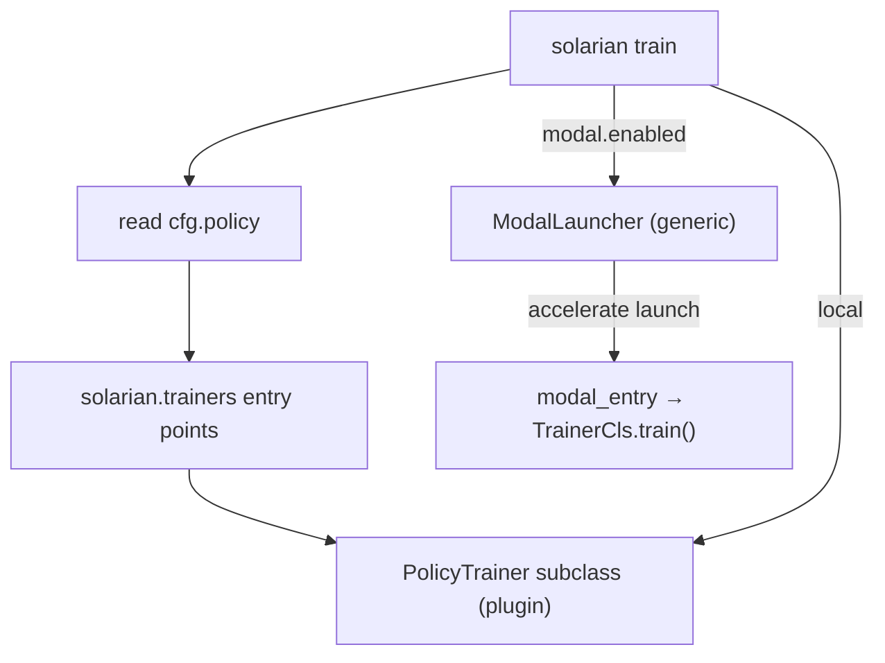

export const metadata = {
  title: 'Training',
  description:
    'Train policies in Solarian via library-agnostic policy plugins: implement a PolicyTrainer, register it under solarian.trainers, and run `solarian train` locally or on Modal.',
}


# Training

Solarian's training is **library-agnostic**. The framework ships only the
generic `solarian train` command plus a small plugin contract; the actual
training logic for a given model family (diffusion, ACT, a VLA, ...) lives in a
**policy plugin**. The same plugin also ships the `PolicyServer` that serves
the trained policy, so a policy is self-contained. {{ className: 'lead' }}



## How `solarian train` works

The command never imports any ML library. It:

1. Reads the `policy` key from the composed config.
2. Resolves the matching `PolicyTrainer` subclass through the `solarian.trainers`
   entry-point group.
3. Validates the config with that trainer's `config_class()`.
4. Resolves an `output_dir` (defaults to `$SOLARIAN_PROJECT_PATH/models/<job_name>`).
5. Runs it — locally (`TrainerCls(cfg, output_dir).train()`) or, when
   `modal.enabled` is set, on Modal via the generic launcher.

```bash
solarian train --conf conf/train
solarian train --conf conf/train-cup-arrange
```

`--conf conf/<file>` composes that yaml instead of the command's default
`conf/train.yaml`.

## A config per task

A trainer plugin ships `templates/train-<name>.yaml`. `solarian install` copies
it into `conf/` once, when that file is not already there. That copy is a base.
Copy it again per task. `policy:` stays the trainer's entry-point name, so
several tasks share one trainer.

```bash
solarian train --conf conf/train-cup-arrange
```

### UMI

`solarian-umi-skill` registers `policy: umi` and seeds `conf/train-umi.yaml`.
Copy it per task (`conf/train-cup-arrange.yaml`, `conf/train-pick-object.yaml`,
`conf/train-place-object.yaml`, ...) and set:

- `job_name` — checkpoints land in `models/<job_name>/`.
- `dataset_path` — that task's `.zarr.zip`, produced by `solarian umi-slam`.
- `config_name` — the Hydra config shipped in the plugin, without `.yaml`.
  The default is `train_diffusion_unet_timm_umi_cup_wild`.

Training runs in this process from the UMI code copied into the plugin. It writes
`models/<job_name>/checkpoints/latest.ckpt`. Pair each training file with a
skill yaml copied from `conf/umi.yaml`, and set that file's
`policy_server.checkpoint` to the same path. The same `UMISkill` loads whichever
file you name:

```python
self.start_skill(UMISkill(params={"config": "cup_arrange.yaml"}))
```

```text
conf/train-cup-arrange.yaml    job_name: cup_arrange
conf/cup_arrange.yaml          policy_server.checkpoint: models/cup_arrange/checkpoints/latest.ckpt
```

The copied training and SLAM code is from
[Universal Manipulation Interface](https://github.com/real-stanford/universal_manipulation_interface),
copyright 2023 Columbia Artificial Intelligence and Robotics Lab, MIT
license. The license text ships beside each copy, as `slam/LICENSE.umi` and `diffusion_policy/LICENSE.umi`.

`solarian umi-slam <session_dir>` turns a directory of GoPro or Lumi collector
MP4s into `<session_dir>/dataset.zarr.zip`, which is the `dataset_path` above.
ORB-SLAM3 runs in Docker image `chicheng/orb_slam3:latest` and GoPro IMU
extraction in `chicheng/openicc:latest`. An image already on the machine is
used as it is. A missing image is downloaded only after you agree.

Cloud training via `modal.enabled` uses the generic Modal launcher. This trainer
does not support it yet.

## The `PolicyTrainer` contract

Defined in
[`solarian/core/ai/system1/policy_trainer.py`](https://github.com/solarian-dev/solarian/blob/main/solarian/core/ai/system1/policy_trainer.py).
A plugin subclasses it and implements `train()`:

```python
from solarian.core.ai.system1 import PolicyTrainer, ModalSpec

class MyTrainer(PolicyTrainer):
    @classmethod
    def config_class(cls):
        return MyTrainConfig         # a TrainConfig subclass

    @classmethod
    def modal_spec(cls):
        return ModalSpec(pip_packages=["torch", "my-lib"])

    def train(self):
        ...  # the real training loop, using self.cfg and self.output_dir
```

| Member | Purpose |
| --- | --- |
| `train(self)` | **Required.** Runs training to completion. |
| `config_class()` | Pydantic schema validating the config (defaults to the thin `TrainConfig`). |
| `modal_spec()` | Declares the container image (apt/pip deps) for cloud training. |
| `add_arguments` / `from_args` / `main` | Standalone CLI launching (e.g. under `accelerate launch`). |

### Thin base config

The framework's `TrainConfig`
([`solarian/core/configs.py`](https://github.com/solarian-dev/solarian/blob/main/solarian/core/configs.py))
only knows common fields — `policy`, `train_dataset`, `val_dataset`,
`output_dir`, `job_name`, `batch_size`, `steps`, logging and a `modal` block —
and uses `extra="allow"`, so any plugin-specific keys (model architecture,
optimizer, ...) pass through untouched. A plugin's `config_class()` is a
`TrainConfig` subclass that re-adds and validates those fields.

## Registering a trainer

A policy plugin advertises its trainer under the `solarian.trainers`
entry-point group and (optionally) a console script for its server:

```toml
[project.entry-points."solarian.trainers"]
my_policy = "my_policy_pkg.trainer:MyTrainer"

[project.scripts]
my-policy-server = "my_policy_pkg.policy_server:main"
```

Then `policy: my_policy` in the train config selects it. Install missing
plugins with `pip install <plugin>`; `solarian train` lists the available
trainers if the requested one isn't installed.

## Cloud training (Modal)

Set `modal.enabled: true` (plus `gpu_type`, `gpus`, `volume`, `secrets`) and the
generic
[`ModalLauncher`](https://github.com/solarian-dev/solarian/blob/main/solarian/core/training/modal_launcher.py)
builds a `modal.Image` from the trainer's `modal_spec()`, mounts a volume at
`/data` for datasets and outputs, and runs the trainer remotely with
`accelerate launch -m solarian.core.training.modal_entry`. Datasets must already
live on the volume — reference them with `/data/...` paths.

```yaml
modal:
  enabled: true
  gpu_type: A100-80GB
  gpus: 2
  volume: solarian-data
  secrets: [wandb]
```

## Reference plugins

- **`solarian-policy-lerobot`** (`policy: lerobot_act`) — trains and serves a
  [LeRobot](https://github.com/huggingface/lerobot) ACT policy.
- **`solarian-umi-skill`** (`policy: umi`) — trains a
  [UMI](https://umi-gripper.github.io/) diffusion policy locally. The same
  plugin's `UMISkill` runs the checkpoint over HTTP. See
  [A config per task](#a-config-per-task).

## See also

- [Skills](/docs/skills) — behaviors that consume a policy server.
- [Servers](/docs/servers) — the `PolicyServer` / `PolicyClient` HTTP contract.
- [Plugins](/docs/plugins) — how Solarian discovers plugins.
