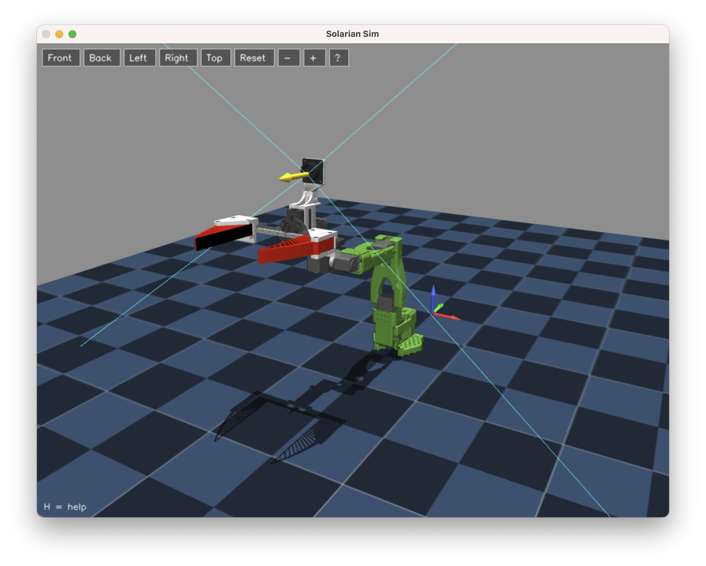

export const metadata = {
  title: 'The gripper',
  description:
    'Install the solarian-gripper1 Feetech gripper from a plugin and attach its model to the arm flange.',
}

# The gripper

The arm was a class you wrote. The gripper is the other way: a module someone else already wrote, installed into the project in one command. {{ className: 'lead' }}


[solarian-gripper1](/hardware/gripper-1) is a two-finger gripper. One servo drives both fingers, and you command it by how far apart the fingertips are, in millimetres. 0 is closed. About 85 is open. The Feetech variant is `Gripper1FeetechModule`.

## Install it

From the project root:

```bash
solarian install gripper1
```

That installs `solarian-gripper1` (and the Feetech driver it depends on, if you skipped it) and records the dependency. This plugin ships the module class and the MuJoCo model inside the package. It does not ship a YAML template, so the config file is still yours to write. The class is what you did not have to write.

## Mount it

Add the attribute. The name `gripper` is the module name from here on. In `my_robot/robot.py`:

```python
from solarian_gripper1 import MJCF_FEETECH_PATH
from solarian_gripper1.gripper_feetech import Gripper1FeetechModule
```

and on the class, under `arm`:

```python
gripper = Gripper1FeetechModule()
```

The gripper's model has to be bolted to the arm, not dropped on the floor. The arm model has a site named `flange`. The gripper model has a site of the same name. Mating site to site is the attachment. Add a second `ModuleAttachment` in the scene's `attachments` list:

```python
ModuleAttachment(
    module="gripper",
    mjcf=MJCF_FEETECH_PATH,
    parent_site="arm/flange",
    child_site="flange",
    prefix="gripper/",
),
```

`parent_site` is a site in the scene *after* the arm's prefix, so it is `arm/flange`, not `flange`. `child_site` is a site in the gripper's own file, before its prefix is applied. `MJCF_FEETECH_PATH` points at the model inside the installed package. You do not copy meshes for the gripper.

`my_arm_module.py` does not change. The arm does not know it has a tool. The scene does.

## Config

Add a port to `conf/deployment/localhost.yaml`. On the real robot the gripper shares the arm's bus; using the same path now means Tutorial 3 does not have to invent a second adapter.

```yaml
actuator_port_gripper: /dev/ttyUSB0
```

Create `conf/modules/gripper.yaml`:

```yaml
actuator_port: ${deployment.actuator_port_gripper}
frequency: 50
interpolator_type: scalar

actuators:
  gripper:
    id: 7
    port: ${actuator_port}
    mode: range_m100_100
    sim_joint: "gripper/left_manifold_to_rail"
    sim_range_min: 0.0
    sim_range_max: 0.0545
    sim_drive_mode: 1
```

`id: 7` keeps the gripper off the arm's 1–6. `sim_joint` is the one prismatic joint the gripper model actuates; an equality in the model drives the other finger the opposite way, so one command opens both. `sim_drive_mode: 1` flips the direction so −100 in normalized space is closed and 100 is open, matching the module. You command millimetres. The module converts.

The filename is `gripper.yaml` because the attribute is `gripper`.

## Schema and keys

Add the gripper to the observation and the action, or the class check fails at startup.

In `my_robot/observation.py`:

```python
class MyGripperObs(ModuleObs):
    gripper = SensorField(MyRobotRobot.gripper.gripper.pos)


class MyRobotObservation(Observation):
    arm = MyArmObs()
    gripper = MyGripperObs()
```

In `my_robot/action.py`:

```python
class MyGripperAction(ModuleAction):
    gripper = ActuatorField(MyRobotRobot.gripper.gripper.pos)


class MyRobotAction(Action):
    arm = MyArmAction()
    gripper = MyGripperAction()
```

`MyRobotRobot.gripper.gripper` is the module `gripper`, then its one servo, which the plugin also calls `gripper`.

The gripper also speaks `MOVE_J`, the type `Gripper1FeetechModule` handles, and its value is millimetres of fingertip opening, 0 to 85. The teleop skill gets two more keys for it. In `my_robot/skills/teleop.py`, add a separate table under `_KEYS`, so `JOINTS` stays the arm's six:

```python
_GRIPPER_KEYS = {"z": -5, "x": 5}
```

In `setup`, start the opening half open, so you can see the fingers:

```python
def setup(self):
    self._target = None
    self._opening_mm = 40.0
```

and at the end of `control_step`, send the gripper its own `MOVE_J` when `z` or `x` was pressed. The whole method becomes:

```python
def control_step(self, dt):
    arm = self.params["arm"]
    if self._target is None:
        obs = self.observations[arm].latest()
        if obs is None:
            return None
        self._target = {joint: float(obs[joint].value) for joint in JOINTS}
    keys = [event.data["key"] for event in self.events if event.type == EventType.KEY_DOWN]
    data = {}
    steps = [_KEYS[key] for key in keys if key in _KEYS]
    if steps:
        for joint, delta in steps:
            self._target[joint] = max(-100.0, min(100.0, self._target[joint] + delta))
        data[arm] = {
            "action_type": ActionType.MOVE_J,
            "data": {j: {"value": v} for j, v in self._target.items()},
        }
    grip = sum(_GRIPPER_KEYS[key] for key in keys if key in _GRIPPER_KEYS)
    if grip:
        self._opening_mm = max(0.0, min(85.0, self._opening_mm + grip))
        data[self.params["gripper"]] = {
            "action_type": ActionType.MOVE_J,
            "data": {"gripper": {"value": self._opening_mm}},
        }
    if not data:
        return None
    return Action(action_type=ActionType.MODULE_ACTION, data=data)
```

The skill now writes two modules, so it needs both names. In `my_robot/controller.py`, bind the gripper in the tool:

```python
"teleop": Tool(JointTeleopSkill, {"arm": "arm", "gripper": "gripper"}),
```

## Look at it

Restart the robot, the server, and the controller. The sim arm should be wearing the gripper. `z` closes the fingers, `x` opens them. The arm keys from the previous chapter still work.



<Note>
  If the gripper shows up on the floor, or the process dies naming <code>flange</code>, the parent site is wrong. It has to be <code>arm/flange</code>: the arm prefix plus the site in the arm model. <code>gripper/flange</code> is the gripper's own site after attachment, which is not the parent.
</Note>

Next: [the camera](/docs/tutorials/first-robot/camera).
