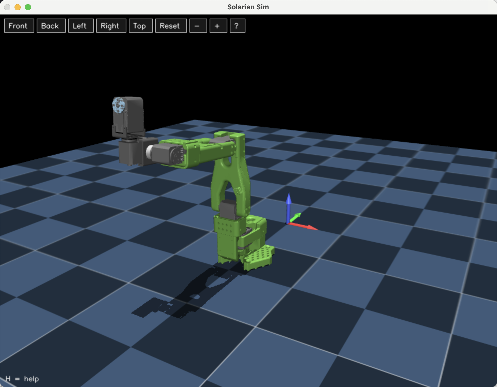
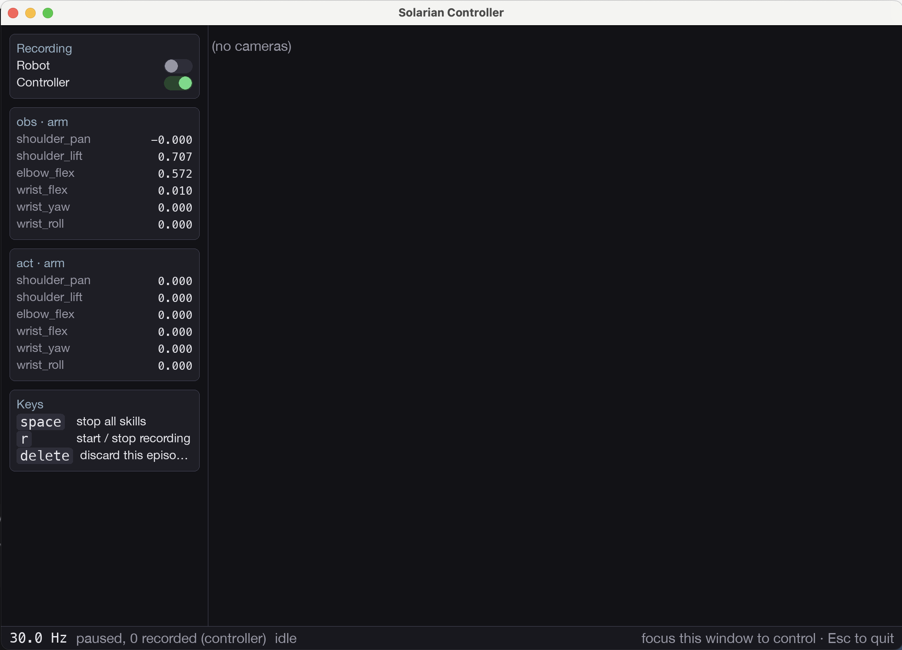

export const metadata = {
  title: 'Move it',
  description:
    'Run the Solarian Arm 1 project in MuJoCo and move the arm with the keyboard.',
}

# Move it

Restart the three processes from the project root. {{ className: 'lead' }}

<CodeGroup>

```bash {{ title: 'Terminal 1' }}
solarian run-server
```

```bash {{ title: 'Terminal 2' }}
solarian run-robot --sim --view
```

```bash {{ title: 'Terminal 3' }}
solarian run-controller
```

</CodeGroup>

Two windows matter:

- The **Solarian Sim** window, opened by the robot because of `--view`. You should see the arm standing on the checker floor, at mid-travel. That pose is all zeros.
- The **Solarian Controller** window. It is mostly empty until the camera exists. It is still where the keys go, so click it before you type.

Press `s` a few times from the controller window. The shoulder should lift. Press `w` and it should come back. Walk the pairs from the [keyboard page](/docs/tutorials/first-robot/keyboard): pan, lift, elbow, then the three wrist joints. The wrist is small on screen. If pan and lift work and the wrist seems dead, move the camera in the sim window (drag to orbit) and look at the flange.





Quit with Control-C in each terminal when you are done looking.

## If the arm is there and will not move

The usual cause is a `sim_joint` that does not exist in the composed scene. The model names the joint `shoulder_pan`. The attachment prefix turns that into `arm/shoulder_pan`. The YAML has to use the prefixed name. The error at startup names the joint it could not find.

The second cause is the controller window not having focus. Keys go to whichever window you clicked last. Click the controller, then press `s` again.

The third is a `TypeError` before anything starts, naming `arm` or a joint. The robot attribute, the YAML filename, and the observation and action fields disagree. The [project page](/docs/tutorials/first-robot/project) has the table.

## If there is no sim window

First check that the robot command has `--view`. Without it the sim runs headless. `--view` is best-effort. With no display, the sim runs headless and the arm is still moving; you just cannot see it. A laptop with a display should show the window. Leave `--view` off to run headless on purpose.

## What you just ran

Same module class, same YAML, same controller as the real arm will use. Simulation swapped the Feetech bus for MuJoCo because you passed `--sim`. Nothing in `my_arm_module.py` mentions MuJoCo. The scene and the `sim_joint` lines are the entire simulation-specific part.

`solarian run-robot` without `--sim` would try to open `/dev/ttyUSB0` instead. Leave that until the arm exists on the desk.

Next: [add the gripper](/docs/tutorials/first-robot/gripper).
