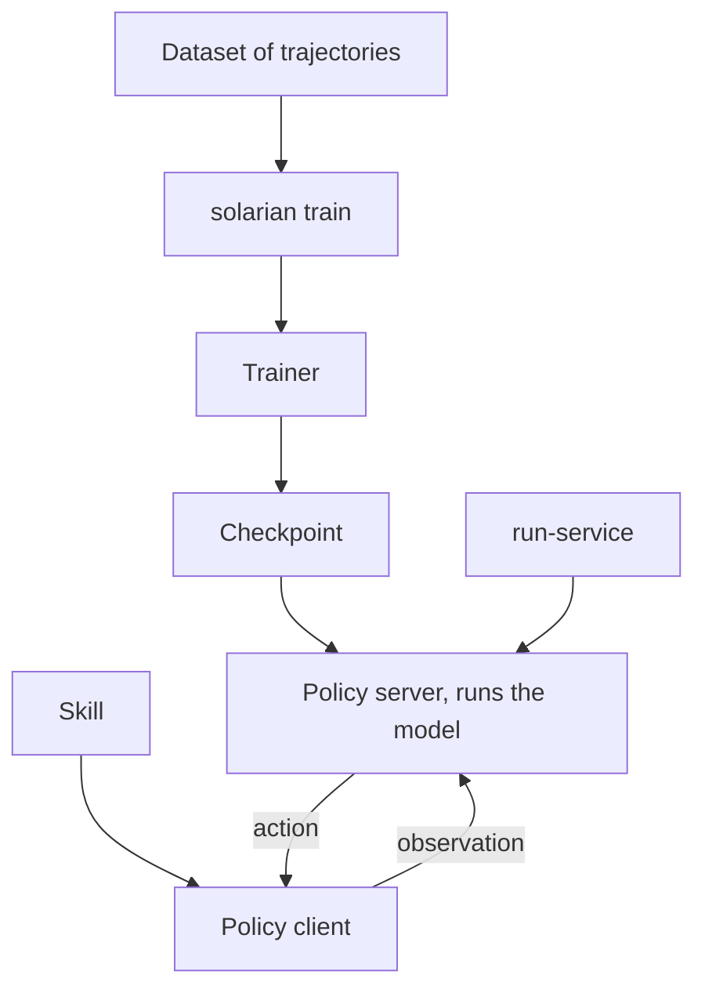

export const metadata = {
  title: 'Policies and learning',
  description:
    'What a policy is, the language of states, observations, actions, dynamics and trajectories, and how robots learn policies: imitation learning, diffusion policies, ACT, VLAs, and reinforcement learning.',
}

# Policies and learning

So far, the "decide" step of the loop has been you, or code you wrote, choosing the next pose. This chapter names that step, gives you the words researchers use for it, and walks through the main ways a robot learns it from data. {{ className: 'lead' }}

## What a policy is

A **policy** is the decide step written as a function: an observation goes in, an action comes out. Researchers write it *π(a | o)*, read "the policy's action *a* given the observation *o*".

A policy comes in two kinds.

- A **written policy** is code a person wrote. The keyboard controller in [Tutorial 2](/docs/tutorials/first-robot) is one: a key press goes in, a joint nudge comes out. So is a scripted pick that moves to a hover pose, descends, closes the gripper, and lifts, using inverse kinematics for every step.
- A **learned policy** is a neural network. Its shape is fixed in advance, and its millions of numbers, the **weights**, are fit to data until the network outputs good actions.

<PolicyKindsFigure />

Written policies are exact and easy to check, and they work when a person can spell out the rule. Learned policies take over where the rule is too hard to write: where exactly to put the fingers on *this* cup, seen from *this* camera.

## States, observations, and actions

Five words describe every robot task.

- The **state** *sₜ* is everything that decides what happens next, at time *t*: the joint angles and velocities, the pose of the cup, the friction of the table.
- The **observation** *oₜ* is what the sensors return: the six encoder angles and the wrist image. It is a part of the state, seen through the sensors.
- The **action** *aₜ* is what the policy writes: joint targets, a hand pose, the gripper width.
- The **dynamics** are the rule that gives the next state from the current state and the action. On a real robot that rule is physics. The policy never sees it written down; a simulator such as [MuJoCo](https://mujoco.org/) is an approximation of it.
- The **reward** *rₜ* is a number that scores how well the task is going. Only reinforcement learning uses it.

Put together, these form a **[Markov decision process](https://en.wikipedia.org/wiki/Markov_decision_process)**, or MDP: states, actions, dynamics, and reward. *Markov* names one assumption: the next state depends only on the current state and action, so the present holds everything needed to predict the future.

A robot only ever sees observations, so its real problem is *partially observed*. A single image hides how fast the cup is sliding, and the gripper hides what is behind it. Policies make up for it by reading a short history of observations and several sensors at once.

Run the loop and it leaves a **trajectory**, the sequence *o₀, a₀, o₁, a₁, o₂, …*. An episode in a Solarian dataset is exactly that: a recorded trajectory.

<MdpFigure />

## Two ways to learn a policy

**Imitation learning** learns from demonstrations. A person does the task while the robot records the observations and actions, and the network learns to output the person's action for each observation. In its simplest form, **behavior cloning**, it is plain supervised learning on (observation, action) pairs. Demonstrations come from teleoperation with a leader arm or a space mouse, or from a hand-held gripper like [UMI](https://umi-gripper.github.io/)'s, which records a person's hand directly.

Imitation has one well-known weakness, **compounding error**. Every small mistake moves the robot a little away from the states in the demonstrations, where the policy is less sure, so the next mistake is larger. Good datasets include recoveries, and good policies predict several steps at once, which leaves fewer chances to drift.

**Reinforcement learning** learns from reward. The robot tries, a reward says how well it did, and the policy changes to collect more reward next time. It needs no demonstrations, and it pays for that with many trials. The last section of this chapter covers it.

## Why plain regression falls short

The first idea for imitation is regression: train the network to output an action, and penalize the squared distance to the demonstrated action. That squared distance is the **L2 loss**, and its best answer is the *average* of the demonstrations.

Averages break on real demonstrations, because people solve the same task in different ways. Facing an obstacle, half the demonstrations pass it on one side and half on the other. Each one is a good path. Their average goes straight into the obstacle.

<MultimodalFigure />

The same averaging shows up in quieter ways:

- **Timing.** One person pauses before the grasp and another moves straight in. The average creeps, slower and more hesitant than either.
- **Switching.** When the two choices are nearly tied, small changes in the image flip the prediction from one to the other between steps, and the arm jitters.

A distribution with several peaks is called **multimodal**, and each peak is a *mode*. The fix is to learn the whole distribution and then pick one mode.

## Learning a distribution

A policy that learns a distribution outputs a *sample*: one good action, drawn from the spread of actions the demonstrators took. Draw twice and you may get one side of the obstacle once and the other side the next time. Each sample commits to one.

There are three common ways to learn one.

- **Bins.** Split each action dimension into, say, 256 bins, and predict a probability for each bin, the way a language model predicts the next word.
- **Mixtures.** Predict a few candidate actions and a weight for each.
- **Diffusion and flow models.** Learn to turn random noise into a good action, step by step.

### Diffusion policies

A **diffusion policy** ([Chi et al., 2023](https://diffusion-policy.cs.columbia.edu/)) uses the same idea as the image generators that turn noise into a picture, applied to a short trajectory of actions.

- **Training.** Take a chunk of demonstrated actions, add a random amount of noise to it, and train the network to predict that noise, given the observation. A network that can predict the noise can remove it.
- **Inference.** Start from pure noise, the size of a trajectory. Remove a little predicted noise, and repeat for a fixed number of steps, until a clean trajectory is left. Every step reads the observation, so the result fits what the camera sees.
- **Execution.** Run the first few actions of the trajectory, then take a fresh observation and generate the next one.

<DiffusionFigure />

Because it starts from random noise, each run can land on a different mode, and each run lands cleanly on one. **Flow matching** is a close relative that learns a straighter route from noise to action, so it needs fewer steps. The UMI policy in this course is a diffusion policy: [Tutorial 4](/docs/tutorials/skills/umi) runs one and [Tutorial 5](/docs/tutorials/training) trains one.

## ACT, the Action Chunking Transformer

**ACT** ([Zhao et al., 2023](https://tonyzhaozh.github.io/aloha/)) came with ALOHA, a pair of low-cost arms that learned fine two-handed tasks, such as opening a small condiment cup and slotting a battery, from about fifty demonstrations each.

- **Inputs.** The images from each camera pass through a ResNet, a standard image network, into a grid of features. The current joint positions join them.
- **Model.** A transformer encoder mixes all those features. A transformer decoder then answers *k* learned queries at once, one per future step, so a single prediction is a **chunk** of the next *k* actions. The paper uses 100 steps, two seconds at 50 Hz.
- **Style variable.** During training, a small encoder reads the demonstrated chunk and compresses *how* it was done into a short vector, a [CVAE](https://en.wikipedia.org/wiki/Variational_autoencoder) latent. The decoder learns to use it, which soaks up the differences between demonstrators. At test time the vector is set to zero, the average style.
- **Loss.** The predicted chunk is compared to the demonstrated one with an L1 loss, the sum of absolute differences.

**Chunking is the key idea**. A policy that commits to two seconds of motion makes far fewer decisions per task, so errors have fewer chances to compound, and pauses in the demonstrations stop confusing it.

ACT then smooths the motion with **temporal ensembling**. It predicts a fresh chunk at every step, so at any moment several overlapping chunks each hold a prediction for *now*. The executed action is their weighted average, with the oldest prediction weighted most.

<ActionChunkFigure />

In Solarian, the [`solarian-umi-skill`](/plugins/solarian-umi-skill) plugin trains diffusion policies from data collected from a UMI handheld device, and serves it for inference as policy service. See [Training](/docs/training).

## VLAs, vision-language-action models

A **VLA** starts from a vision-language model, a network pretrained on a large share of the internet's images and text, so it already knows what a cup is and what "the red one on the left" means. Training then teaches it to output actions.

- **Inputs.** Camera images, an instruction such as "put the red cup in the bowl", and usually the robot's joint state.
- **Outputs.** Actions, in one of two styles:
  - *Action tokens.* Each action dimension is split into bins, and the model writes the bins out as extra words. RT-2 and [OpenVLA](https://openvla.github.io/) work this way.
  - *An action expert.* A smaller network attached to the language model generates a continuous chunk of actions with flow matching. [π0](https://www.physicalintelligence.company/blog/pi0), SmolVLA, and GR00T N1 work this way.
- **Training.** First on demonstrations from many different robots, such as the Open X-Embodiment collection, then **fine-tuned** on demonstrations from your robot and your task.

<VlaFigure />

The language model is what VLAs add: they follow new instructions and handle objects their robot demonstrations never showed. They are also large, run on a GPU, and take longer per prediction, so they usually output chunks and run a few times a second.

Solarian also uses a vision-language model one level higher. The [AI Agentic Controller](/docs/agentic_controller) reads the scene and the instruction and chooses *which skill* to start, and the skill's own policy moves the arm: a slow planner on top of a fast policy, the split the glossary calls [System 1 / System 2](/docs/glossary#system-1-system-2).

## Reinforcement learning for robotics

In **reinforcement learning**, the policy is called the *agent*. It acts, the dynamics move the world, and a reward scores the result. The sum of the rewards over an episode is the **return**, and training changes the policy to make the expected return as high as possible.

The methods fall into three families.

- **Policy gradient**, such as **PPO**. Run the current policy, see which actions led to high return, and make them more likely. It needs many fresh trials after every update, and it is simple and stable. Most legged robots learn to walk this way.
- **Off-policy actor-critic**, such as **SAC** and **TD3**. A second network, the *critic*, learns how much return each action leads to, and the policy, the *actor*, follows the critic. Old trials stay useful, so it needs far fewer of them, which matters on a real robot.
- **Model-based**, such as **Dreamer** and **TD-MPC**. Learn the dynamics as a network, then practice or plan inside that learned model.

Real robots are slow, fragile, and need someone to reset the scene, so most robot RL runs in simulation and transfers the policy to hardware, **sim-to-real**:

- **Parallel simulation.** Simulators such as Isaac Lab and MuJoCo Playground run thousands of copies of the robot at once on a GPU, so a policy collects years of experience in hours.
- **Domain randomization.** Every copy gets slightly different masses, friction, motor strength, latency, and lighting, so the real robot looks like one more variation.
- **Reward design.** The reward has to describe the task without leaving loopholes. Shaped rewards add partial credit, such as distance to the cup, so the agent finds the goal at all.

Manipulation is harder for RL than walking. Contact with objects is hard to simulate accurately, cameras are harder to randomize than joint angles, and "the cup is in the bowl" is harder to score than "the body moved forward". So manipulation work often combines RL with the other ideas in this chapter:

- **Demonstrations plus RL.** Start from a few demonstrations, train on the real robot, and let a person step in when it goes wrong. [HIL-SERL](https://hil-serl.github.io/) learns precise real-world tasks this way within a few hours of practice.
- **Learned rewards.** A small image classifier, trained on examples of success, scores each attempt.
- **Fine-tuning.** Train a policy by imitation first, then improve it with RL. A *residual* policy learns a small correction added on top of the imitation policy's action.

<RlFigure />

## In Solarian

A **[skill](/docs/skills)** is one behavior the controller can start and stop. Move to a pose, open the gripper, or run a learned policy are all skills. A skill reads the latest observation and returns the next action.

A learned policy is a skill whose decision comes from a model. The model runs in its own process, a **[policy server](/docs/policies)**. A policy server is a **[service](/docs/services)**: a model other programs call over HTTP. [`solarian run-service`](/docs/commands#run-service) starts that process and loads a checkpoint into it, so the model stays in memory and answers each request. The skill reaches it through a **policy client**, which sends the observation and reads the action that comes back. The client is the same for every kind of model. Swapping a diffusion policy for ACT, or for a VLA, changes the server and leaves the skill alone.

The checkpoint is what a **[trainer](/docs/training)** writes. A trainer reads a dataset of recorded trajectories, the observation and the action of every tick, and fits the network's weights until those pairs come back out. [`solarian train`](/docs/training) is the command that runs one. The checkpoint it writes is the file `solarian run-service` loads.

Notice what the policy leaves to the earlier chapters. Its action can be in **[joint space](/docs/tutorials/gentle-intro-to-robotics/configuration#joint-coordinates-and-task-coordinates)** or in **[task space](/docs/tutorials/gentle-intro-to-robotics/configuration#joint-coordinates-and-task-coordinates)**, and Solarian supports both. A joint-space action is one target per joint, so the motors can follow it directly, and it fits only the arm it was recorded on: another arm, jointed differently, cannot replay those angles. A task-space action is the hand's pose. Inverse kinematics has to turn it into joint targets, and that fails when the pose is out of reach, but the motion itself does not depend on how the arm is jointed.

Solarian leans toward task space, through the [`solarian-umi-skill`](/plugins/solarian-umi-skill) plugin. A UMI model transfers to a new arm with no new training, as long as that arm wears the same UMI gripper and has at least six degrees of freedom, enough for inverse kinematics to meet the commanded pose. The demonstrations are faster to collect too: a hand-held UMI collector records the person's own hand, instead of teleoperating the robot for every episode.

Either way, the interpolator times the motion and PID in each servo holds the joints. The person who demonstrated the task already chose a path around the obstacles.

{/* <PolicySurvey /> */}

[Tutorial 4](/docs/tutorials/skills/umi) runs a trained policy as a skill. [Tutorial 5](/docs/tutorials/training) records demonstrations and trains one.

Next: [your first Solarian robot](/docs/tutorials/first-robot).
