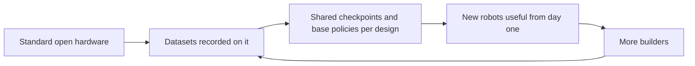
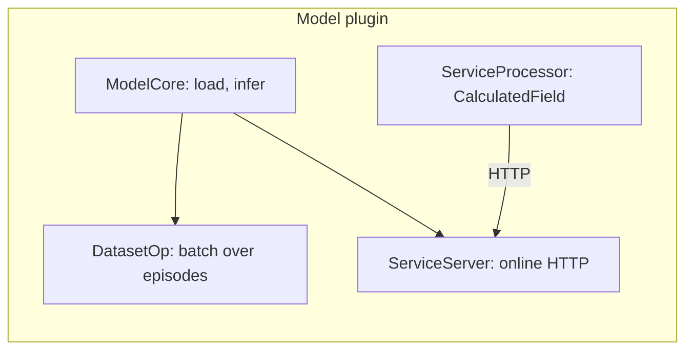
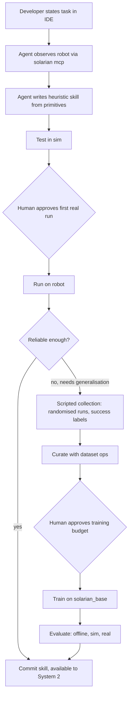

# RFC 0001: An agent-native Solarian

- **Status:** Draft
- **Date:** 2026-10-16
- **Scope:** `solarian` (the open-source framework and its plugins) and `solarian_base` (the cloud platform)

## 1. Summary

AI coding agents now write most of the code in a robotics project. This RFC
re-states where Solarian adds value under that assumption and proposes the
architecture that follows from it:

- **solarian** is architecture, opinions, taste and standards earned by
  building and testing robots in the physical world, packaged as the contracts,
  runtime and verification loops an agent builds a robot on. Alongside it,
  **open-source hardware**, already designed, built and tested, low cost,
  integrated with the software and assemblable by a non-expert. Project code
  (robots, skills, configs) is what the agent writes; the framework makes that
  code short, checkable and hard to get subtly wrong.
- **solarian_base** is infrastructure designed specifically for Solarian
  robots: GPU compute with models kept warm for inference, terabyte-scale
  storage with versions and lineage, sharing, security, fleet scale, low-latency
  placement, and a GUI, APIs and MCP for people and their agents. It never
  reimplements framework logic; it *runs* solarian code on cloud storage and
  GPUs, and on GPUs the customer owns.

Section 3 states that value proposition and questions the parts of it that only
hold with qualification. Three concrete designs carry the rest: a **model
plugin with one core and three faces** (dataset op, service server, service
processor), a **dataset op contract** with immutable versions and provenance,
and a **train/inference parity contract** that checks a deployed policy sees
inputs produced the way its training inputs were.

## 2. Motivation

### 2.1 What changed

A coding agent can scaffold a project, write a module driver, a skill or a
training config in minutes. The cost of *writing* code has collapsed. The cost
of *being wrong* has not: a skill that confuses millimetres with metres, a
camera field computed on the wrong host, or a bounding box that was tracked
backwards from the grasp at training time but forwards from a click at
inference time all produce a robot that fails quietly. An agent produces these
bugs at the same speed it produces everything else.

### 2.2 The test for value

One question sorts what we build: *could a capable coding agent, given a
weekend and an API key, reproduce this?* If yes, it is not where our value is,
however much effort it took us. If no, it is, and the work is to make it
reachable by that same agent.

Things fail the test for one of three reasons. They need the physical world (a
robot, a part, a measurement). They need resources a laptop does not have
(GPUs, terabytes, a fleet, a network spread over regions). Or they need
accumulated judgement that does not exist in a model's training data.

## 3. The value we add

### 3.1 Solarian: tested judgement, not code volume

Solarian's value is architecture, opinions, taste, best practices and standards
that came from building robots for a long time and testing them in the physical
world. It is the result of a great deal of exploration, and tokens, already
spent. An agent starting from scratch pays that cost again and walks into the
same dead ends, because the dead ends are not in its training data.
Concretely:

- **Contracts that encode physical facts.** Units and bands on every field,
  coordinate frames, execution place, latency per module, and the same transform
  at training and at inference time.
- **A runtime that is efficient where it matters.** Shared-memory observation
  buffers, a control loop that does not jitter, processors that never block the
  observation stream, video recorded raw and remapped at export.
- **Lessons from real failures.** A few from this codebase: the camera's latency
  was being counted twice; wrist-camera frames reached the VLM with red and blue
  swapped; a fisheye's black border spent half the VLM's pixel budget on
  nothing; a zip member cannot be replaced in place, and a zip interrupted
  mid-write loses the whole session; HTTP clients and compiled Jinja templates
  do not survive the `spawn` start method.
- **Verification loops.** Simulation from the same MJCF models as the hardware,
  replay, and calibration and verification commands.

This value reaches an agent only if it is legible. A lesson written in a comment
inside `think.py` helps an agent that happens to open that file. A lesson
enforced by a contract, a test or a `doctor` check helps every agent on every
project. Turning accumulated judgement into enforced checks is therefore a
first-class work item (principle 8), not documentation polish.

### 3.2 Open-source hardware

Hardware is harder than software for humans and agents alike. There is little
training data for it, mistakes cost parts and days, and sourcing, tolerances and
assembly order are tacit knowledge. Solarian ships hardware that is already
designed, built and tested (the Solarian Arm 1, the UMI-slim gripper, the Lumi
handheld collector), at minimal cost, integrated with the framework (drivers,
calibration commands, and a MuJoCo twin exported from the same Onshape CAD by
`solarian onshape-export`), and meant to be assembled by someone who is not a
hardware expert.

Two consequences:

- **Hardware should be as agent-readable as software.** The CAD, the MJCF twin
  and the drivers exist today; a bill of materials, assembly steps and per-step
  checks do not exist as data an agent can follow. Section 6.11 proposes a
  hardware package, so an agent can guide a non-expert through sourcing and
  assembly and check each step with commands that already exist
  (`detect-device`, `calibrate`, `verify-calibration`) and with the robot's own
  camera.
- **Standard hardware makes data and policies portable.** A dataset recorded on
  one Solarian Arm 1 trains a policy that runs on another. That is the root of the
  network effect in section 3.5.

### 3.3 Solarian Base: infrastructure designed for Solarian robots

Solarian Base is infrastructure built specifically for robots built with
Solarian. It knows the session format, the observation schema, the cameras and
their calibration, the relay and the deployment files, so everything below
works on a Solarian project without integration work.

- **GPU compute.** Buying, setting up and maintaining GPU servers is not a good
  use of a robotics team's time. Training and dataset enrichment run in bursts,
  and Base runs them on demand. For inference, Base keeps models preloaded and
  warm, so a robot gets fast responses and can switch between models (a tracker,
  a depth model, a new policy checkpoint) without a cold start.
- **Storage.** Datasets and checkpoints grow to terabytes quickly, and
  multi-camera video at raw rate is the bulk of it. Base stores them with
  versions and lineage, streams video by range, and decodes and samples frames
  on the server, so neither a person nor an agent downloads a session to look
  at it. Layered versions (section 6.3) keep storage proportional to new data,
  not to the number of curation steps.
- **Sharing.** Datasets, checkpoints and robots live in one place a team and its
  agents can reach, instead of on one person's computer.
- **Security.** CURVE-encrypted robot links, scoped tokens, audit logs and
  organisation boundaries, done once and correctly instead of by every team.
  Robots are actuators, and agents with tool access are a new attack surface:
  an instruction injected through a camera image or a dataset description must
  not turn into motion. On Base, motion is a separate scope, gated and audited.
- **Scale.** From one robot to thousands. Scaling a fleet is more than servers:
  a connection file per robot (exists today), project images built from git and
  rolled out across robots (the build exists for hosted controllers), per-robot
  calibration and health. Adding a robot should be downloading a file, not an
  infrastructure project.
- **Low latency.** Inference servers placed close to robots and colocated with
  the relay each robot already connects through. Building that across regions is
  expensive and slow for a single team.
- **Cost.** Cheaper than building and running your own, because Base amortises
  GPUs, storage and operations across many robots and teams.
- **A GUI** a team would not build from scratch: the synchronised multi-camera
  viewer with time series and 3D, curation, job monitoring, teleoperation
  through the hosted relay.
- **APIs and MCP** for AI coding agents, so a team's agents can curate, train,
  deploy and inspect robots without the team building and securing that layer.

### 3.4 Where the pitch needs care

Some of these claims hold for some users and some loops and not others. The
qualification changes the design, so it belongs here rather than in marketing.

- **"Using your own compute doesn't make sense."** True for training and
  enrichment bursts, and for teams without GPUs. Not true for every inference
  loop: one that must keep running when the network drops, or that needs
  single-digit-millisecond latency, belongs on the robot or on a GPU on the
  robot's network. The point-and-pick deployment does exactly that today, with
  its policies and tracker on a LAN host (`turing.local` in
  `conf/deployment/pi.yaml`). Teams that already own GPUs, and customers with
  data-residency requirements, will want to use them. **Proposal:** Base
  manages compute it owns *and* compute the customer owns, as nodes running the
  same images and services, deployed and monitored from the same place.
  Bring-your-own-GPU becomes a feature instead of a lost customer, and Base's
  value is the control plane, not only the GPU-hour.
- **"Low latency from distributed servers."** Regions shorten a round trip;
  they cannot remove it. A wide-area round trip plus inference is tens of
  milliseconds. What makes cloud inference work for a robot is co-design with
  the framework: action chunks (a diffusion policy predicts a horizon, not a
  step), fields that lag one round trip by design instead of blocking
  (`ServiceProcessor`), per-module latency calibration, and defined behaviour
  when the link drops. A generic cloud cannot offer this because it does not
  know the robot's latency budget. **Proposal:** fields and skills declare a
  latency budget and what to do on link loss; Base recommends placement from
  measured latency; `doctor` flags a placement that cannot meet its budget.
- **"Cheaper through economies of scale."** At first Base rents GPUs, so it
  will not beat a hyperscaler's price per GPU-hour. It is cheaper than what a
  team would otherwise do: reserve a GPU that sits idle most of the day, and
  pay an engineer to keep it running. The margin comes from utilisation: many
  robots sharing warm model servers, batching, scaling to zero. **Technical
  consequence:** services must be multi-tenant. Today the SAM 2 server holds a
  single tracking session, so every robot needs its own GPU process. Session
  ids and batched inference across robots (section 6.6) are what make the
  economics work.
- **"A GUI and an MCP you would not build yourself."** In the agent era these
  are precisely what an agent builds quickly: a dashboard or an MCP wrapper is
  an afternoon. Their value is what sits behind them: terabytes of video served
  by range, the managed relay, the GPUs, the lineage. So the GUI and MCP should
  be excellent but open: forms rendered from schemas, viewer components a
  project can embed, and an API complete enough that an agent can build a
  project-specific panel on it. Compete with agents on the backend; cooperate
  with them on the front end.
- **Generic versus specific.** Compute, storage, sharing, security, scale and a
  GUI are table stakes. They must be good, but on their own they are what
  hyperscalers, Hugging Face, Weights & Biases and Modal already sell. The
  reasons to choose Base are the robotics-specific ones: it knows the Solarian
  schema, runs the relay and the fleet, serves models tuned for robots (warm,
  stateful, per-robot sessions, latency-aware placement), checks train/inference
  parity, and holds lineage from hardware revision to deployment.

### 3.5 Network effects: the moat an agent cannot generate

Code can be generated; data from the physical world cannot. Because Solarian
hardware is standard, data and policies recorded on one robot are useful on
every robot of the same design. That allows a loop no single team can build
alone:



Base is the natural home for it: datasets and checkpoints published with
visibility controls and licences, tagged with the hardware design and revision
they were recorded on, and carrying quality signals (episode counts, success
rates, parity reports). `session.json` already records the robot's structure;
adding the design and revision is a small step. The hub itself is beyond the
phases of this RFC, but the phases must not foreclose it: hardware revision in
sessions, organisation-scoped visibility and lineage are its prerequisites, and
all three are in scope.

### 3.6 What stops being a moat

Volume of code, breadth of built-in integrations, hand-written glue between our
own components, and front ends on their own. If an agent can write it in an
afternoon from a good contract, the contract is the product and the code is
disposable.

## 4. Principles

1. **Small, opinionated core; generated periphery.** The core defines contracts
   and the runtime. Project-specific code is expected to be written by agents
   against those contracts.
2. **One declaration, every surface.** A typed declaration (a Pydantic params
   model, a `Data` field, a skill signature) is the single source for CLI flags,
   REST endpoints, GUI forms, MCP tools and System 2 tool schemas. No surface is
   hand-maintained.
3. **The base runs solarian; it never reimplements it.** A dataset operation,
   trainer or service that runs on solarian_base is the same code a developer
   runs locally with the same command.
4. **Nothing is mutated in place.** Every dataset operation produces a new
   version with provenance. Deleting episodes is a filter, not a rewrite. This
   is what makes it safe to hand dataset operations to an agent.
5. **API first.** Every capability of solarian_base is an endpoint before it is
   a page. The GUI is one client; the CLI and MCP are others.
6. **Discoverable by introspection, not by reading code.** An agent should be
   able to ask a project what it contains and get a machine-readable answer.
7. **Fast feedback before hardware.** Every authoring path an agent takes should
   have a way to verify it without the robot: sim, replay, or a dataset.
8. **Lessons become checks.** When we learn something the hard way, it lands as
   a contract, a test or a `doctor` check, not only as a comment or a page. Our
   accumulated judgement is only an asset to the agents that can run into it.
9. **Agent-nativeness is measured, not asserted.** A fixed set of tasks is run
   by a fresh agent against every release (section 6.9). A regression in its
   success rate, tokens or human interventions is a bug.

## 5. Current state

What exists today and is reused:

- **Services.** `solarian/services/` defines `Service`, `ServiceServer`
  (FastAPI) and `ServiceProcessor` (a `CalculatedField` that calls a server from
  a worker thread without blocking the observation stream). Discovery is the
  `solarian.services` entry-point group. `plugins/solarian-sam2-tracker` is the
  one live service.
- **Recording.** `solarian/core/recording/` writes native sessions
  (`session.json`, `manifest.jsonl`, `episodes/NNNNNN/{episode.json,
  episode.parquet, video/*.mp4}`) and exports LeRobot v2.1.
  `recording/schema.py` already describes every column with its unit and band.
- **Training.** `solarian train` with trainers registered under
  `solarian.trainers`; `PolicyTrainer.modal_spec()` declares a cloud image and
  `plugins/solarian-modal` runs it on Modal.
- **Hardware.** The Solarian Arm 1 and the UMI-slim gripper have MJCF twins exported
  from their Onshape assemblies by `solarian onshape-export`, shipped in their
  plugins' `assets/`. The Lumi collector has scripts that build its enclosure
  in Onshape (`solarian-lumi-collector/cad/`). Device setup, calibration and
  verification are commands (`setup-module`, `calibrate`,
  `verify-calibration`).
- **System 2.** `core/ai/system2/think.py` (`ThinkProcess`) renders Jinja
  prompts, calls an OpenAI-compatible VLM, parses a JSON decision and starts or
  stops skills. Skills are described to it by their docstrings.
- **solarian_base.** Django + DRF + Channels backend and a Next.js GUI.
  Datasets (`lerobot`, `zarr`, `solarian` formats) with a viewer, a
  `DatasetOperation` model, Celery tasks that shell out to scripts, S3-compatible
  storage, and hosted relays and controllers for cloud robots
  (`controller/runtime.py` launches processes locally or in Docker;
  `controller/connection_file.py` emits the deployment yaml a robot needs).

What is wrong today:

- **The session format has four independent readers.**
  `solarian/core/recording/session.py`, `solarian_base/scripts/solarian_io.py`
  (whose docstring says the layout is "restated here" because neither package
  is installed), `solarian_base/backend/api/dataset_utils.py:SolarianDataset`,
  and `solarian_umi/diffusion_policy/dataset/solarian_session.py`. Every
  format change has to land in four places.
- **The same model is implemented twice.** Offline tracking for training
  (`solarian_base/scripts/solarian_track.py`, `sam2_tracking.py`,
  `track_video.py`) does not share code with online tracking at inference time
  (`solarian_sam2_tracker/server.py`). The bbox train/inference skew diagnosed
  in the point-and-pick work came from exactly this seam: training boxes were
  tracked backwards from the grasp, inference boxes forwards from a click.
- **Dataset curation is scripts.** The richest operations (merge, split,
  mirror, track, masks, depth) are CLI scripts in `solarian_base/scripts/`. The
  API exposes a subset, and the Celery tasks it defines are never enqueued
  (`backend/api/views.py`, the `TODO: Trigger Celery task`). Delete-episodes
  rewrites the dataset in place.
- **No agent surface.** No `AGENTS.md`, no machine-readable introspection of a
  project, no OpenAPI schema, no API tokens (JWT only), no MCP.
- **Depth is vendored twice and wired nowhere.** Depth Anything V2 and Video
  Depth Anything live in both `solarian/perception/vision/` and the
  solarian_base root, as library code with no service or dataset op.
- **Services are single-tenant.** The SAM 2 server holds one camera predictor
  and one tracking session, so each robot needs its own GPU process.
- **Hardware is not data.** There is no bill of materials, no assembly sequence
  and no record of the hardware revision in a session, so an agent cannot
  guide an assembly and a dataset does not say which hardware it came from.

## 6. Design

### 6.1 The model plugin: one core, three faces

A plugin that wraps a perception model (a tracker, a depth estimator, a
detector) exposes the model once and builds every use of it on that one core:



- **ModelCore** loads weights and runs inference. It knows nothing about HTTP,
  episodes or observations. It is the only place preprocessing (resize,
  normalisation, colour order) is defined.
- **DatasetOp** runs the core in-process over recorded episodes to enrich a
  dataset for training (section 6.2). It may use modes the online path cannot,
  such as tracking backwards in time, but it must declare them.
- **ServiceServer** hosts the core behind HTTP on a GPU machine
  (`solarian run-service <name>`), exactly as today.
- **ServiceProcessor** is the `CalculatedField` a project declares so the
  observation carries the result, exactly as today.

The plugin advertises its op next to its service:

```toml
[project.entry-points."solarian.services"]
sam2-tracker = "solarian_sam2_tracker.service:Sam2TrackerService"

[project.entry-points."solarian.dataset_ops"]
sam2-tracker-track = "solarian_sam2_tracker.op:TrackOp"
```

and the op names its online counterpart (`service = "sam2-tracker"`), which is
what the parity contract (section 6.4) checks against.

### 6.2 Dataset operations

#### Contract

An op is a small, typed, pure transformation over episodes. The *runner* owns
everything else: reading and writing sessions, parallelism, progress, versions
and provenance. This split is deliberate: the part an agent writes for a new
heuristic is a few lines, and the part that is easy to get wrong is written
once.

As built in Phase 1 (`solarian/datasets/op.py`):

```python
class OpKind(str, Enum):
    MAP = "map"          # episode -> the same episode with members added or replaced
    FILTER = "filter"    # episode -> keep or drop
    EXPAND = "expand"    # episode -> episodes on one or more named outputs
    COMBINE = "combine"  # several sessions -> one


class DatasetOp(ABC):
    name: ClassVar[str]
    title: ClassVar[str]
    description: ClassVar[str]
    kind: ClassVar[OpKind]
    Params: ClassVar[type[BaseModel]]
    #: Named outputs; an op that splits a session writes several.
    outputs: ClassVar[tuple[str, ...]] = ("out",)
    resources: ClassVar[Resources] = Resources()
    #: Members this op writes, relative to the episode directory.
    produces: ClassVar[tuple[str, ...]] = ()
    #: The service whose online processor must reproduce this op's output.
    service: ClassVar[str | None] = None
    #: False for an op holding one stateful model on one device.
    parallel: ClassVar[bool] = True
```

Each kind implements one hook, called once per episode by the runner:
`map(episode, params, ctx) -> EpisodeOut | None` (None keeps the episode as it
is), `keep(episode, params, ctx) -> bool`, `expand(episode, params, ctx) ->
Iterable[(output, EpisodeOut)]` and `combine(inputs, params, ctx)`. `setup`
validates params against the input once, before anything is written, and
`session_meta` rewrites `session.json` when an op changes it. An op that
derives an episode with `episode.derive(files, **meta)` stores only `files`;
everything else is read through from its source.

A split is an `EXPAND` with two outputs rather than a kind of its own:

```python
class SplitPickPlaceOp(DatasetOp):
    name = "split-pick-place"
    kind = OpKind.EXPAND
    outputs = ("pick", "place")
    Params = SplitParams

    def expand(self, episode, params, ctx):
        split = find_split(episode.table().column(f"obs.{params.module}.{params.axis}"), params)
        yield "pick", self._half(episode, 0, split + 1)
        yield "place", self._half(episode, split, episode.n_rows - split)
```

A `MAP` op is parallel across episodes by construction, which is what lets the
base fan a GPU op out over many workers.

#### Discovery and the CLI

Ops come from three places, and each catalog entry says which in `source`:

- **Built-ins** (`builtin`) in `solarian/datasets/ops/`: `delete-episodes`,
  `split-pick-place`, `mirror` and `merge`; `trim`, `recompute-stats` and
  `export-lerobot` later.
- **Plugins** (`plugin:<dist>`), through the `solarian.dataset_ops` entry-point
  group, the same way `discover_services()` finds services. Model-backed ops
  live in their model plugins: `track` in `solarian-sam2-tracker`.
  `solarian create-plugin op <name>` scaffolds one with its entry point.
- **The project** (`project:<path>`), by convention and with no registration:
  every `<package>/dataset_ops/<op_name>.py` is an op, next to `skills/` and
  `modules/`, so it can import project code. The file defines one `DatasetOp`
  subclass; its name is the class's `name`, else the file stem with `_` turned
  into `-`. The project is the one around the current directory, or
  `--project`. New projects ship one example, `drop_short_episodes.py`, and
  `solarian add-op <name>` writes another from the same template. A project op
  moves to a plugin by moving the file and adding one entry-point line.

A project op with the name of a plugin or built-in op takes its place, and the
catalog marks it with `overrides`. A file that fails to import, or that defines
zero or two ops, is listed by `dataset ops` with its path and error; like a
broken plugin, it hides no other op.

```bash
solarian dataset ops [--json]              # installed ops; --json is the catalog
solarian dataset describe track            # one op, params as JSON Schema
solarian dataset info <path> [--json]      # episodes, cameras, targets, lineage
solarian dataset run split-pick-place data/cups -o pick=data/pick -o place=data/place
solarian dataset run track data/pick --param 'prompt={frame: 0, point: [640, 400]}'
solarian dataset materialize <version> out.solarian.zip   # or `-` for stdout
```

`run` and `materialize` are the low-level primitives over standalone
sessions. Day-to-day work goes through computed datasets (section 6.3), whose
commands build on them:

```bash
solarian dataset new data/cups data/cups-curated
solarian dataset apply data/cups-curated delete-episodes --param 'episodes=[3, 7]'
solarian dataset apply data/cups-curated split-pick-place
solarian dataset apply data/cups-curated@02-split-pick-place-pick track --online
solarian dataset redo data/cups-curated@03-track 4 --param 'prompt={frame: -1, point: [730, 711]}'
solarian dataset accept data/cups-curated@03-track 4
solarian dataset close data/cups-curated@03-track
solarian dataset log data/cups-curated [--json]
solarian dataset export data/cups-curated@03-track cups-pick.solarian.zip
solarian dataset drop data/cups-curated@03-track
solarian dataset rebuild data/cups-curated data/cups-curated-again
```

Params are validated by the op's Pydantic model, and an unknown param name is
refused rather than silently defaulted. `--progress-json` prints one JSON line
per event (`progress`, `log`, `result`, `error`), which is how solarian_base
follows a job it launched.

#### Episode by episode

A MAP or FILTER op can also run one episode at a time, without changing the op
contract. `OpSession` (`solarian/datasets/op_session.py`) calls `setup` once,
so a model stays loaded, and then `map` or `keep` for one episode per request,
rewriting that episode's members, the manifest and `version.json` atomically.
Overrides go through the op's own params: `track` gets the episode's `prompt`,
and `delete-episodes` a keep or a drop.

`solarian dataset session <dir>@<version>` serves this over JSON lines, for
programs such as solarian_base and agents. Requests on stdin are
`{"episode": k, "params": {...}}` (redo a MAP episode), `{"episode": i,
"keep": false}` (decide a FILTER one), `{"accept": k}` and `{"close": true}`;
events on stdout are `ready`, `started`, `result` (with each camera's
coverage and `box_area`), `kept`, `accepted`, `closed`, `log` and `error`. A
request's `id` comes back on its events. `redo` and `accept` are the same
requests as one-shot commands.

`track` tracks an episode when it has a prompt: its own in `prompts`, else the
default `prompt`. Both are optional, so `track --online` starts with nothing
tracked and each episode is tracked as it is prompted. In batch, a correction
is a redo of the bad episodes with their own prompt; the rest keep their
targets and are not stored again.

#### Canonical format

The native session is the canonical format. LeRobot and zarr datasets are
*exports*, produced by ops and recorded as versions like any other, so they
carry lineage back to the session they came from. The UMI path already defaults
to `.solarian.zip`; `load_session_replay_buffer` reads sessions directly; zarr
becomes a training-time cache rather than a storage format.

#### One reader

`Session` and `SessionWriter` moved from `solarian_base/scripts/solarian_io.py`
into `solarian/core/recording/archive.py`. Ops, `materialize` and the UMI
loader (through `.solarian.zip`) read through them. solarian_base does not
import solarian: Django and solarian live in separate environments, so the
base runs the CLI for everything that writes, and its `SolarianDataset` follows
`version.json` itself to find a member for the viewer. The read-through rule is
three lines (own member, else `session.json` from the first parent, else the
parent episode named by `src`), so the duplication is cheaper than the coupling.

### 6.3 Versions and lineage

#### Computed datasets

A recorded session is never edited. A **computed dataset** is a directory over
one source session that holds a tree of versions, each made by one op from its
parent, the source or another version:

```
data/cups-curated/
    computed.json      {"format": 1, "source": "../cups", "versions": {
                         "03-track": {"parent": "02-split-pick-place-pick", "op": "track",
                                      "params": {...}, "output": "out", "state": "open",
                                      "source": "plugin:solarian-sam2-tracker",
                                      "episodes": {"0": {"status": "accepted", "params": {...}}}}}}
    versions/03-track/ a version, in the layer format below
```

- **Keys and refs.** A version's key is `<nn>-<op>[-<output>]`, numbered in
  the order ops were applied; the outputs of one apply share a number.
  `data/cups-curated@03-track` addresses it; without `@`, a command
  takes the only leaf and refuses when there are several. `source` is the
  source session.
- **Open and closed.** A MAP or FILTER version applied with `--review` or
  `--online` stays open while its episodes can be redone and reviewed. Each
  episode's review state (`pending`, `done`, `accepted`, plus a FILTER's
  `keep`) lives under the version in `computed.json`. A MAP review is keyed by
  the version's own episodes; a FILTER review by the parent's, since the
  version no longer has the episodes it dropped. Batch mode processes every
  episode first (`done`), online mode none (`pending`). `close` freezes the
  version, and ops apply only on closed versions, so nothing a version reads
  through to changes under it.
- **Drop and export.** `drop` deletes a version and everything built on it.
  `export` flattens a version into a standalone session, which can be the
  source of another computed dataset.
- **The file is the code.** `computed.json` records every op, its params, its
  source (with the project's git commit for project ops) and every
  per-episode redo, so `rebuild` replays it from the source and reproduces the
  dataset.

#### Layers

A version stores only what it changes:

```
<version>/
    version.json    {"format": 1, "parents": ["../<parent>"], "op": {...},
                     "episodes": [{"src": [parent position, parent episode]} | {"src": null}]}
    manifest.jsonl
    episodes/NNNNNN/episode.json + the members this version adds or replaces
```

- A **FILTER** version is a `version.json` with an episode list, the episodes'
  `episode.json` and nothing else. Deleting 83 of 85 episodes from a real UMI
  session wrote a 6 kB version.
- A **MAP** version holds only the members it produced (for example
  `targets/camera0.npz` or `video/camera0.depth.mp4`); the videos stay in the
  parent.
- A **COMBINE** version lists episodes from several parents under new indices.
- `solarian dataset materialize <version>` (and `export`, for a computed
  dataset's version) flattens a chain into a standalone `.solarian.zip` for
  download, training on a machine without the chain, or sharing.

Every produced member carries a provenance record, kept in the version and
mirrored into `episode.json` under `provenance[<member>]`:

```json
{
  "op": "sam2-tracker-track",
  "plugin": "solarian-sam2-tracker",
  "plugin_version": "0.3.1",
  "git_sha": "1a2b3c4",
  "params": {"model": "small", "direction": "backward_from_last"},
  "model": {"name": "sam2.1_hiera_small", "sha256": "..."},
  "mode": "offline_bidirectional",
  "inputs": ["<parent version id>"],
  "created_at": "2026-10-16T15:00:00Z"
}
```

Lineage then reads end to end: session, versions, training run, checkpoint,
deployment.

### 6.4 Train/inference parity

A policy trained on enriched inputs makes an implicit promise: at inference
time the same inputs are produced the same way. Solarian makes the promise
explicit and checks it.

1. **The checkpoint records its inputs.** A trainer collects the provenance of
   every member and column it consumed and writes it into the checkpoint's
   metadata as `input_provenance`.
2. **Deployment checks it.** When a skill starts a policy, it resolves each
   enriched input to the `CalculatedField` that produces it live and compares:
   same plugin, same model and checkpoint hash, compatible params. A mismatch in
   plugin or model fails the start; a mismatch in mode (offline bidirectional
   against online forward) warns, and quotes the latest parity report.
3. **A parity op measures the skew.** `parity` replays each episode's frames
   through the plugin's online processor path, seeded the way an operator would
   seed it, and compares against the offline targets (IoU for boxes and masks,
   relative error for depth). The report is a version artefact and is shown in
   the GUI next to the dataset.

The point-and-pick bbox investigation becomes a standard check rather than a
week of diagnosis.

### 6.5 solarian_base as the executor

#### Jobs

The base mirrors computed datasets (section 6.3) rather than inventing its own
lineage. A `Dataset` is `uploaded` or `computed`; a computed one has a
`source` and a tree of `DatasetVersion` rows (parent, key, op, params, output,
state, the review JSON, totals), one per entry of the `computed.json` it owns.
An export is an `uploaded` dataset with `exported_from` pointing at its
version. So the dataset list shows uploaded and computed datasets only, never
an intermediate version.

- `POST /api/datasets/` with `{"kind": "computed", "source", "name"}` starts
  one; `GET /api/datasets/{id}/versions/` returns the tree with its
  operations.
- `POST /api/datasets/{id}/versions/` with `{parent, op, params, mode:
  batch|online, inputs}` queues a `DatasetOperation` that runs `solarian
  dataset apply ... --progress-json`; the version is `processing` until it
  ends, then `open` or `closed`, or `failed`.
- `POST .../versions/{key}/close/`, `DELETE .../versions/{key}/` (the
  subtree) and `POST .../versions/{key}/export/` with `{name}` run `close`,
  `drop` and `export`.
- The viewer's info, series, video, outline and download endpoints take
  `?version=<key>`; base follows `version.json` itself to find a member.

Every command runs in the project's environment: cwd is the project checkout
(`SolarianProject`, else `CONTROLLER_LOCAL_PROJECT_DIR`), so project ops load,
and `GET /api/ops/?project_id=` caches the catalog per project.

**Review sessions.** `POST .../versions/{key}/episodes/{i}/` with `{params}`,
`{keep}` or `{accept: true}` returns 202 and queues the request in Redis. A
Celery task, `run_op_session`, on a dedicated `interactive` queue with its own
worker (so a batch run never holds a review up), runs `solarian dataset
session` and forwards requests over stdin. It writes each episode's status,
coverage and error into `DatasetVersion.episodes`, which the page polls, and
exits after five idle minutes; the next request starts another. On the page,
review plays the tracked camera through a WebCodecs frame player, in either
direction and with exact frame numbers, so a pick can be prompted on its last
frame, where the object is in the gripper.

Later phases generalise it into `Job`:

- `kind`: `dataset_op`, `train`, `eval`, `service`
- `spec`: op or trainer name, validated params, input version ids
- `status`, `progress`, `logs`, `outputs` (version ids, checkpoint ids)
- `backend`, `resources`, `image` (solarian version and plugin versions)
- `created_by`: the user or the token, so an agent's actions are attributable
- `cost`: for GPU jobs, recorded and bounded by a budget

A job runs the same CLI a developer runs:
`solarian dataset apply <dir>@<parent> <op> --params-json ... --progress-json`.
The base parses progress lines into the job and syncs the versions it wrote. A run on the base is therefore reproducible locally, and a
bug found locally reproduces on the base.

#### Backends

- **Celery** for CPU ops and development (the worker exists; jobs are simply
  enqueued now).
- **Modal** for GPU ops and training, reusing the `ModalSpec` pattern: an op
  declares its `resources` and its plugin declares its image; the backend never
  imports plugin code to build it.
- **Customer-owned nodes.** A GPU machine the customer owns (in their lab, on
  the robot's network, or in their own cloud account) joins Base as a managed
  node: it dials out like a robot does, pulls the same images, and runs jobs
  and services that Base schedules and monitors. It reuses
  `controller/runtime.py` (`LaunchSpec`, `DockerRuntime`). Section 3.4 explains
  why this is a first-class backend rather than a fallback.

#### Custom ops

A user's own op lives in their project (`<package>/dataset_ops/`) or plugin.
Today the base runs it from the local project checkout. The base already
builds a project's Docker image from git or a bundle for hosted controllers
(`SolarianProject`, `controller/build.py`); running ops in that same image is
the next step. Untrusted code needs sandboxing on shared GPUs (section 9).

#### Op catalog

`GET /api/ops/?project_id=` returns every op the project sees with its kind,
resources, `produces`, `source`, `overrides`, whether it can run episode by
episode (`online`) and the JSON Schema of its params. The dataset page renders
the form from the schema, so a new op, including a project's own, gets a GUI
with no frontend change. `POST /api/datasets/{id}/versions/` starts a job.

### 6.6 Models as hosted services

An **Endpoint** runs `solarian run-service <name>` on a GPU backend against a
deployment and records its URL, checkpoint, GPU, status and idle timeout
(services scale to zero; a robot's first call wakes them). It is not called a
"service deployment": Base already has Deployments (code snapshots) and
solarian has deployment confs (where a robot's nodes run), and a third meaning
would make every sentence about the connection file ambiguous. "Endpoint"
names what the robot sees, a URL it calls.

A policy is a service with a checkpoint, so one command and one model cover
both. `run-policy` was merged into `run-service`; a conf's `server:` block
(service, checkpoint, args, `managed`) says what runs, whether the conf is a
service conf or a skill conf. `ServiceServer` and `ServiceClient` are the
framework, and `PolicyServer`/`PolicyClient` are thin subclasses adding the
policy routes.

`connection_file.py` emits each running endpoint's URL, and the project's
endpoint token, into `conf/deployment/solarian_base.yaml`, keyed by the conf
key the endpoint fills (`bbox_tracker_url`, `pnp_policy_server_url`). A
robot's own deployment `extends:` that file, so a project switches from a local
tracker or policy to a hosted one by changing deployment, not code. The
connection file can be downloaded without the relay block for a robot that
keeps its own relay and only uses the endpoints.

What exists (phase 3, part 2):

- `solarian modal-serve <name>` deploys a conf's server as a Modal app with
  `@modal.web_server`. The URL is derived from a label, so it is stable across
  restarts and known before the deploy finishes. Base labels endpoints
  `sb-<project>-<slug>`, one per project and conf key: starting a new endpoint
  for `pnp_policy_server_url` replaces the old one once its own deploy
  succeeds, and the connection file never has to change.
- `Endpoint` in Base: `POST /api/projects/{id}/endpoints/` with a servable (a
  conf with a `server:` block from the deployment's manifest), an optional
  training job checkpoint, a GPU type, warm containers and an idle timeout. A
  Celery worker runs `solarian modal-serve` inside the deployment; beat
  reconciles status every 30 s from Modal's app state without polling health,
  so a scaled-to-zero endpoint stays asleep. Only checkpoints Base's own
  training jobs wrote can be served; they are on the project's volume already.
- Auth: `ServiceServer` checks a bearer token from `$SOLARIAN_ENDPOINT_TOKEN`
  (empty means open, for local use) and `ServiceClient` sends it. Base keeps
  one token per project, encrypted at rest, and passes it to every endpoint.
- Surfaces: **Services & Policies** (endpoints across all projects, with
  start, stop, restart, logs and health) and **Models** (every training job's
  checkpoints, with **Serve**); `solarian base models ls` and
  `solarian base endpoints ls|start|stop|logs`, with `--json`.

Not yet: sessions and batching (below), warm pools, latency budgets, per-endpoint
tokens and backends other than Modal.

#### Warm, multi-tenant model servers

The economics and the "fast inference and switching" promise both rest on one
change to the service contract: a server holds many sessions, not one.

- **Sessions.** Every call carries a session id (one per robot and field). A
  stateful model such as the SAM 2 camera predictor keeps one memory bank per
  session instead of one per process, so many robots share a GPU process.
- **Batching.** A server may batch frames from several sessions into one
  forward pass. `ServiceServer` gains an optional batched hook; a model that
  cannot batch keeps the per-call path.
- **Warm pools.** Base keeps popular models loaded across regions and loads a
  robot's own checkpoints on its nodes ahead of use. Switching a robot from one
  checkpoint to another is a request, not a cold start.

#### Placement and latency

Latency decides placement:

- solarian_base already hosts the relay for cloud robots. A field declared with
  `execution_place: server` is computed on that relay, so a hosted service is
  colocated with it and the robot pays one network hop, the one it already
  pays.
- A loop that cannot afford a wide-area round trip (30 Hz tracking on a robot
  not connected through the base) runs the same service image on a
  customer-owned node on the robot's network, managed from Base like any other
  deployment.
- A field or skill declares a **latency budget** and its **link-loss
  behaviour** (hold the last value, stop the skill, or fall back to a local
  model). Base measures the real round trip per robot and placement, recommends
  where a service should run, and `doctor` flags a placement that cannot meet
  its budget.

Hosted services need authentication: a bearer token checked by
`ServiceServer` and sent by `ServiceClient`, which phase 3 part 2 added.

### 6.7 One API, three surfaces

Every capability is a REST endpoint first, described by an OpenAPI schema
(drf-spectacular) and following one asynchronous contract: a `POST` returns a
job id; the job exposes status, progress and streamed logs. The surfaces are
clients of that API:

- **GUI** for humans: the viewer, curation by eye, approvals, cost.
- **CLI** for agents in an IDE: `solarian base login`, `datasets
  push|pull|ls|info`, `ops run`, `jobs status|logs`, `train`, `endpoints start`,
  all with `--json`. Coding agents are fluent in shells, so this is the primary
  agent surface.
- **MCP** for agents outside a project (section 6.8).

Authentication adds **personal access tokens** with scopes (`datasets:read`,
`datasets:write`, `jobs:run`, `endpoints:write`, `robots:control`), named for
where they live ("cursor on raul-mbp") and shown in an audit log. Robot tokens
stay separate. `robots:control` is never granted by default.

Agent safety follows from principle 4 and three additions: destructive-looking
operations produce versions, never rewrites; every job accepts `dry_run` and
returns what would change and an estimated cost; and a token can carry a GPU
budget.

#### Deploy, train, track (phase 3, part 1)

The relation between solarian and Base is the one between Next.js and Vercel. A
project is deployed from the CLI (`solarian base deploy`, a bundle honouring
`.gitignore`) or the GUI (import from git). A **Deployment** is an immutable
snapshot with a build log and a manifest of its trainers and train configs; the
newest ready one is the project's current deployment, and older ones can be
promoted back. A deployed project runs training jobs and serves its services
and policies (section 6.6) against that snapshot.

What exists:

- `solarian base login|logout|whoami|link|deploy|env|manifest|train|runs`, all
  with `--json`, in the `solarian-base` plugin so core stays vendor-neutral.
  `login` is a browser device flow that mints a personal access token.
- `TrainJob`: `POST /api/projects/{id}/train/` with a train config (from a
  deployment) or a stock trainer (params validated by its JSON Schema), Hydra
  overrides, `base://datasets/<id>[@version]` refs and a GPU choice. It returns
  202 and a job; a Celery worker runs `solarian modal-train` inside the
  deployment on Base's Modal account, and beat reconciles status, cancellation
  and checkpoints. The job's process gets a token scoped to `runs:write` for its
  own run, which expires with the job.
- Experiment tracking: `solarian.tracking` has wandb's API with pluggable
  backends (`wandb`, `none`, and `solarian_base` from the plugin), selected by a
  config's `logging.backend` or `$SOLARIAN_TRACKING`. Base stores runs with
  metric history, console logs, tags, notes, config, summary and system info,
  and shows Charts, Overview and Logs per run.
- The OpenAPI schema is served at `/api/schema/` (Swagger at `/api/docs/`), with
  the new endpoints tagged Deployments, Environment variables, Training, Runs
  and Tokens.

Not yet: `dry_run` and cost estimates, GPU budgets on tokens, organisation
scope, typed request and response bodies for the plain `APIView` endpoints, and
backends other than Modal.

### 6.8 MCP

Two servers, both thin.

**solarian_base remote MCP** (streamable HTTP, token auth), generated from the
op catalog and the API:

- `list_datasets`, `describe_dataset`, `sample_frames` (returns images, so an
  agent can *look* at episodes while curating), `list_ops`, `run_op` (with
  `dry_run`), `get_job`, `job_logs`, `train`, `evaluate`, `deploy_service`,
  `list_robots`.
- `list_runs`, `get_run` (summary, config and the launching job) and
  `run_metrics` (sampled history of named keys), so an agent can compare
  experiments and decide what to train next.

`train` maps onto `POST /api/projects/{id}/train/` and takes the same
`base://` dataset refs as the CLI; `get_job` and `job_logs` read the training
job and its run. Until the remote server exists, the `deploy-and-train` skill
shipped by the `solarian-base` plugin covers the same loop through the CLI.

**`solarian mcp`**, a local stdio server run inside a project, for the live
robot or the sim:

- `describe` (the same output as `solarian describe --json`), `observe` (camera
  frames and state), `list_skills`, `start_skill`, `stop_skill`,
  `send_command` (to System 2), `record_episode`, `sim_reset`.
- Read-only by default. Motion requires `--allow-motion`, respects the
  workspace and speed limits, and `stop` is always available.

The local server is what lets a coding agent act as System 2 during development:
observe the scene, start skills, see what happens, and then write down what
worked as a skill. It is the bridge to section 6.10.

No MCP for scaffolding, code generation or running CLI commands: inside a
project the agent already has a shell, and every MCP tool costs context in every
session whether used or not.

### 6.9 The agent-readiness pack

What an agent needs to build a Solarian project correctly, beyond the docs:

- **`AGENTS.md`** at the repository root, in every plugin (emitted by the
  `create-plugin` template) and in every generated project (emitted by
  `create-project`). It holds the architecture map, the invariants, and the
  commands that verify a change. The durable content of `.cursor/rules/` moves
  here so agents other than Cursor read it too.
- **Agent skills shipped in the wheel** under `solarian/templates/agent/skills/`
  (`SKILL.md` format, readable by Cursor, Claude Code and Codex).
  `create-project` copies them into the project; a plugin can ship its own and
  `solarian install` copies them, as it already copies yaml templates. The first
  set: `new-project`, `add-module`, `add-skill`, `add-service`,
  `add-dataset-op`, `record-and-train`, `deploy`, `build-system1-tool`.
- **`solarian describe --json`**: the project's modules, observation fields with
  units and bands, actions, skills with params schemas, services, ops and
  deployments. Built on `recording/schema.py:build_schema()`.
- **`solarian doctor`**: checks configs against their Pydantic models, required
  deployment keys, installed plugins and reachable services, and says what to
  do about each failure.
- **JSON Schema for configs**, exported from `core/configs.py`, so an editor
  validates project yaml as it is written.
- **`--json` on every command** that reports state.
- **`llms.txt`** generated from the MDX docs.
- **One canonical reference project.** `projects/arm1` is kept clean as the
  example agents copy.
- **Lessons as checks** (principle 8). The lessons in section 3.1 become
  assertions where they can be: a camera field whose colour order is not
  declared, a processor that blocks the observation stream, a zip written
  without the atomic writer, a latency counted in two places. Each one an agent
  would otherwise rediscover.

#### Agent-usability evals

Principle 9 needs an instrument. A small suite of tasks, each a prompt and a
check that passes or fails:

- create a project for a simulated Solarian Arm 1 and make it wave;
- add a skill that moves the gripper to a point given in the camera image;
- split a dataset into good and rejected episodes by a stated heuristic, on Base;
- deploy the tracker as a hosted service and point the project at it;
- diagnose a planted bug (a field computed on the wrong host).

Each task runs with a fresh agent and only what ships (docs, `AGENTS.md`,
skills, CLI, MCP), against every release. The suite records success, tokens,
wall time and the number of times a human had to step in. A drop is a bug
with the same standing as a failing unit test. Running it across agents
(Cursor, Claude Code, Codex) shows where our guidance is specific to one of
them.

### 6.10 System 2 builds System 1

A frontier model can create System 1 tools in two ways: **coded heuristics**
that compose primitives, and **learned policies** trained on data that
heuristics (or a human) generate. Both run through the IDE, with the developer
asking the coding agent and approving the steps that touch hardware or spend
GPU budget.



What solarian provides for this loop:

- **Typed skill params.** Skill params become a Pydantic model. The same schema
  is the tool definition `ThinkProcess` sends with native tool calling
  (replacing docstrings and JSON parsing), the `start_skill` tool in
  `solarian mcp`, and the form in the controller GUI.
- **Primitives** in `solarian.skills.primitives`, so generated heuristics are
  short and reviewable. Perception: `detect(text)` (open-vocabulary detector or
  VLM), `track` (the sam2 service), `point_3d` (depth plus intrinsics plus arm
  pose). Motion: `move_to`, `approach`, `grasp`, `place`, on the existing IK.
- **Success detectors**: predicates over observations, or a VLM judge, used to
  label scripted episodes.
- **Scripted collection**: runs a heuristic skill N times under randomised
  parameters with `SessionRecorder`, labels each episode, and records
  `source: scripted:<skill>@<git sha>` as provenance.
- **The `build-system1-tool` agent skill**, which documents the whole loop and
  its approval points for the coding agent.

The runtime System 2 (`ThinkProcess`) only selects among registered skills. It
never writes code on the robot. Generated skills enter the registry the way all
code does: through a commit, which is the review gate.

### 6.11 Hardware as an agent-readable package

A hardware design ships the way a software plugin does: versioned, installable,
and complete enough that an agent can take a non-expert from an empty desk to a
calibrated robot. A hardware package (for example the hardware half of
`solarian-arm1`) holds:

- **`hardware.yaml`**: design name and revision, the modules it provides, and a
  bill of materials. Each line has a part, a quantity, a unit cost, suppliers
  and acceptable substitutes, and the printed parts point at their meshes and
  print settings.
- **CAD and the twin.** The Onshape document and the MJCF exported from it by
  `solarian onshape-export`, so sim and hardware come from one source.
- **Assembly steps as data.** An ordered list where each step has a short
  instruction, images or renders, the tools and parts it consumes, and a
  **check**: a command (`detect-device`, `setup-module`, `calibrate`,
  `verify-calibration`) or an observation the robot's camera can confirm. An
  agent walks a person through the list and does not move on until the check
  passes.
- **Known failure modes**: the symptoms a wrong assembly produces (a joint that
  reads reversed, a servo on the wrong id, a camera mounted rotated) and the
  check that tells them apart.

The design and revision go into `session.json` when a session is recorded, so
every dataset and checkpoint knows which hardware it came from. That is what
makes a shared dataset trustworthy on someone else's robot (section 3.5) and
what lets `doctor` warn when a policy is deployed on a revision it was not
trained on.

## 7. Non-goals

- **Our own chat or agent harness.** The primary user for the next 6 to 12
  months is a developer in Cursor or Claude Code; those harnesses are free and
  improving faster than we could. A web workbench can come later on the same API
  and MCP.
- **Native support for every dataset format.** LeRobot and zarr are exports.
- **MCP for what the CLI already does.**
- **In-place mutation of datasets**, on any surface.
- **Real-time control loops over the wide-area network.** Hosted services serve
  latency-tolerant fields, or fields computed on the hosted relay. Tight loops
  run on the robot or on a customer-owned node near it.
- **Competing on raw GPU price.** Base rents GPUs at first and cannot undercut
  their owners. It competes on utilisation, robotics-specific serving and not
  having to run infrastructure.

## 8. Phases

Each phase ends with a check that someone other than its author can run.

- **Phase 0: this RFC.** Exit: accepted, with section 9 answered or deferred
  explicitly.
- **Phase 1: dataset ops vertical slice.** The op contract, one session reader,
  the built-in `delete-episodes`, `split-pick-place`, `mirror` and `merge`, the
  sam2 `track` op on a shared model core, `solarian dataset` CLI, and in
  solarian_base lineage on `Dataset`, a single Celery task that runs `solarian
  dataset run`, the op catalog and schema-rendered forms, episode marking and
  click-to-prompt tracking in the viewer, and the download. Exit: on a real
  session, each op run locally and through the base produces output equal to
  the script it replaces; the replaced scripts are deleted.
  *Done:* delete, split, track, a one-episode track correction and mirror ran
  through the base on a real UMI session, and the downloaded `.solarian.zip`
  loaded with `load_session_replay_buffer` (bbox and mask on every frame,
  mirrored poses reflected). `solarian_base/scripts/solarian_*.py` are deleted;
  `sam2_tracking.py` stays for the zarr and LeRobot scripts.
  *Revised after use:* lineage as one `Dataset` per output cluttered the list
  with intermediates, and tracking every episode from one shared prompt was
  wrong too often to trust. Ops now build versions inside computed datasets
  (section 6.3), episode by episode with a warm model when the op allows it,
  reviewed in the browser forwards or backwards; projects define ops in
  `<package>/dataset_ops/`; and the base's `produced_by`/`parents` lineage
  was migrated into computed datasets.
- **Phase 2: agent-readiness pack.** `AGENTS.md`, shipped agent skills,
  `describe --json`, `doctor`, config schemas, `llms.txt`, and a first batch of
  lessons turned into checks; the hardware package for the Solarian Arm 1 (section
  6.11), with the design and revision recorded in sessions; the agent-usability
  eval suite; OpenAPI, organisation scope for projects, datasets and tokens,
  personal access tokens and the `solarian base` CLI.
  Exit: the eval suite runs from one command and its project tasks pass with
  an agent that has no prior context. From here on, the suite runs at the end
  of every phase and its results go in the phase's exit note.
- **Phase 3: services, GPU and parity.** `solarian-depth` with op and service on
  one core; multi-tenant sessions and batching in `ServiceServer`, with the SAM 2
  tracker as the first multi-session service; warm pools; Modal and
  customer-owned-node backends; `Endpoint` with latency budgets and
  link-loss behaviour; provenance in checkpoints, the deployment check and the
  `parity` op; training as a job with lineage. Exit: two robots share one
  tracker process; a policy trained on tracked boxes refuses to start against a
  different tracker model; the point-and-pick dataset has a parity report.
- **Phase 4: MCP and System 2 builds System 1.** The two MCP servers, typed skill
  params with native tool calling, primitives, success detectors, scripted
  collection and the `build-system1-tool` skill. Exit: from "pick up the red
  block", an IDE agent produces a heuristic skill that works in sim, collects
  scripted episodes, trains and registers a policy skill, with exactly two human
  approvals.
- **Beyond Phase 4: the hub** (section 3.5). Published datasets and checkpoints
  per hardware design, with visibility, licences and quality signals. Not
  scheduled here; Phases 1 to 3 build its prerequisites (lineage, hardware
  revision in sessions, organisation scope).

## 9. Open questions

1. **Layered versions on object storage.** Reading a member through a chain of
   zips on S3 may be slow for training. Materialise on first training use and
   cache, or materialise eagerly above some chain depth?
2. **UMI convergence.** When does UMI training read sessions directly, so zarr
   becomes only a cache? What blocks it today besides the masks and bbox
   tooling written against zarr?
3. **Untrusted custom ops.** Running a user's op on shared GPUs needs isolation
   (Modal sandboxes, gVisor, a dedicated pool per organisation). Which, and is it
   needed before the first external user?
4. **Where the base client lives.** `solarian base` in core is convenient but
   ties the open-source framework to one vendor's cloud. Recommendation: a
   `solarian-base` plugin, installed by default in the project template, so the
   core stays neutral.
5. **Agent skills location in a project.** Cursor, Claude Code and Codex read
   skills from different directories. Copy into each, or write one
   `.agents/skills/` and link?
6. **Organisations.** `Organization` and `Membership` exist in the controller
   app but projects and datasets are owned by users. Phase 2 moves them to
   organisation scope because tokens, budgets and shared datasets need it. Open:
   does every user get a personal organisation, so existing data migrates
   without a choice?
7. **Service pricing.** Scale-to-zero suits occasional use but a cold start
   stalls a robot's first frames. Warm pools per deployment, or a cold-start
   policy the skill can wait on?
8. **What Base charges for.** If customer-owned nodes are first-class, GPU-hours
   cannot be the only price. Per robot, per managed node, per seat, storage, or
   a mix? The answer decides whether bring-your-own-GPU is a growth path or a
   leak.
9. **The open-core boundary.** What must work without Base? Recommendation:
   everything one team needs for one robot (record, run ops, train on its own
   GPU, serve models) runs locally from the open-source framework. Base wins on
   scale, sharing, fleet, latency and convenience, not by withholding features.
   This matters for agents in particular: an agent routes around a closed
   dependency when it can, and recommends against it when it cannot.
10. **Hub policy.** Default visibility of datasets, consent for recordings with
    people in frame, and licences for shared datasets and checkpoints. Not
    needed until the hub, but the default visibility of an upload has to be
    chosen now.
11. **Hardware kits.** Publish designs only, or also sell kits? A kit turns the
    bill of materials into one item a person can order and makes part quality
    controllable, which is most of what "assemblable by a non-expert" depends
    on.

## 10. Alternatives considered

- **Keep curation as base-side scripts.** The status quo. It keeps the four
  readers and the two implementations of each model, so train/inference skew
  stays structural, and every new op needs a script, a task, a serializer and a
  page.
- **Adopt LeRobot as the canonical format.** It is the de facto exchange format,
  and export already produces it. It does not hold raw-rate multi-camera video,
  sidecars (tags, targets), optical remap metadata, or per-member provenance,
  all of which curation and parity need. Export covers interoperability.
- **Build ops on Ray Data or Hugging Face datasets.** Both are good executors.
  The contract (episodes, members, provenance, versions) is ours either way;
  Ray can become a backend behind the same runner if fan-out outgrows Modal.
- **MCP as the only agent surface.** An IDE agent works better with a CLI it
  can compose, pipe and script, and MCP tools cost context in every session.
  MCP is for agents with no shell in a project.
- **A web chat agent in solarian_base now.** Commoditised, and aimed at a user
  (non-developers) who is not the primary one yet. The API and MCP built here
  are what such a workbench would need, so the option stays open.
- **Base as a GPU reseller only.** Simple to price, but it makes Base a thin
  layer over its own GPU suppliers, loses every team that owns GPUs, and puts
  the value where an agent can reproduce it (any agent can script a GPU
  provider's API). The control plane over owned and customer-owned compute is
  harder to reproduce and keeps those teams.
- **A closed GUI and MCP as the product.** Tempting because they are what
  people see, but an agent can build a dashboard or an MCP wrapper in an
  afternoon. Making them open and schema-driven lets agents extend them
  instead of replacing them.
